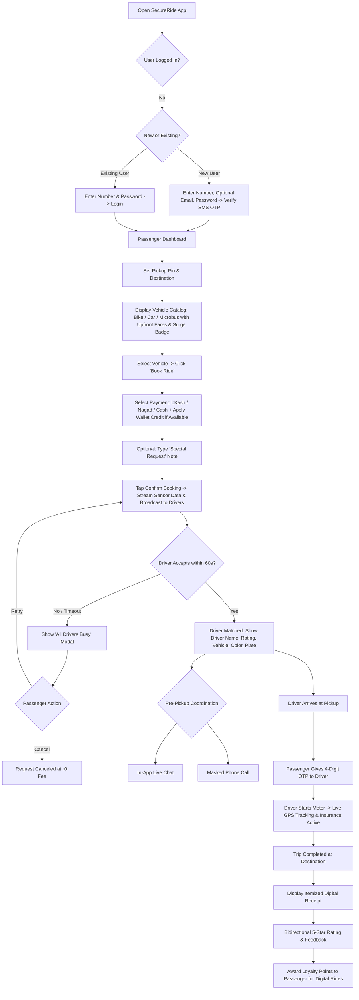
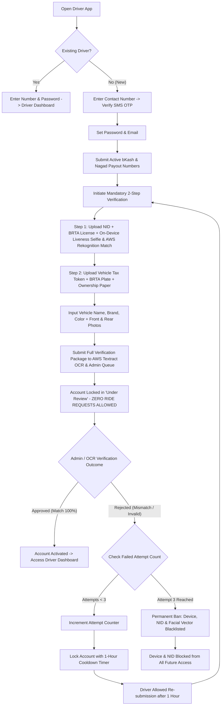
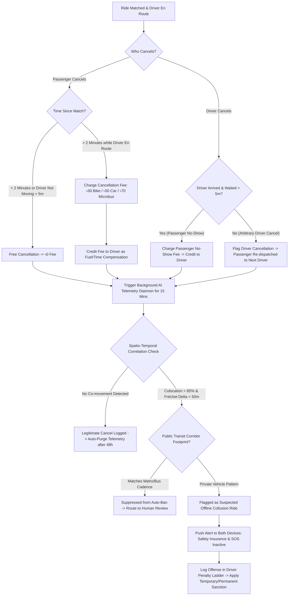
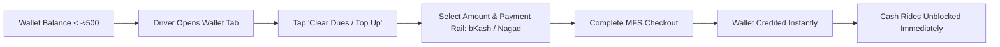
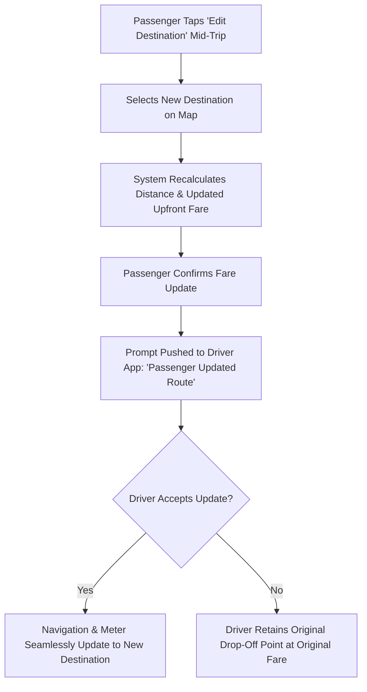

# Product Requirements Document (PRD)
## Project Name: SecureRide (Working Title)
**Tagline:** Smart Ride-Sharing with Guaranteed Safety, Transparent Pricing, and Zero-Brokerage Gaps.  
**Version:** 5.0 (Enterprise Production Specification — Fully Validated, Gap-Resolved & Architecture-Aligned)  
**Document Owner:** Product Management & Technical Architecture Team  
**Status:** Approved / Development & Sprint Ready  

---

## 1. Project Overview

### 1.1 Executive Summary
**SecureRide** is an on-demand ride-sharing platform engineered to eliminate revenue leakage, safety risks, and arbitrary fare haggling in emerging markets (primary launch market: Bangladesh). The platform operates a two-sided marketplace connecting **Drivers (Captains)** who share and provide rides with legally verified vehicles, and **Passengers** who search, customize, and book rides.

Its primary technological differentiator is an **Anti-Offline Ride AI Engine** paired with transparent upfront vehicle-fare cataloging, dynamic algorithmic surge management, seamless payment choices (bKash, Nagad, Cash), passenger digital change wallets, custom passenger ride requests, a bidirectional rating system, loyalty point rewards, integrated free transit insurance, and a zero-tolerance **Multi-Step Driver & Vehicle Verification Gateway** backed by on-device biometric liveness detection and strict 3-strike device/NID blacklisting.

### 1.2 Core Problem Statement
1. **Revenue Leakage:** Drivers and passengers bypass the platform post-match for offline cash rides, costing the platform its 10%–12% commission.
2. **Safety & Liability Risks:** Offline rides operate without real-time GPS telemetry, background safety monitoring, SOS triggers, and transit insurance.
3. **Vehicle & Identity Fraud:** Unverified drivers operating uninspected vehicles, mismatched number plates, or vehicles not covered by their driving license create severe passenger hazards.
4. **Driver-Passenger Trust Deficit:** Lack of clear upfront vehicle pricing, arbitrary cancellations, uncompensated driver travel, and missing communication channels degrade platform reliability.

### 1.3 Vision & Strategic Goals
- **Vision:** To become the most trusted, legally compliant, and safety-guaranteed ride-sharing platform in the region.
- **Strategic Goals & Milestones:**
  - **Month 1–3 (Cold Start & Supply Acquisition):** Onboard 1,000 verified drivers in Dhaka; achieve 100% KYC compliance before ride dispatch.
  - **Month 4–6 (Retention & Fraud Deterrence):** Reduce post-match cancellations and offline leakage by **>70%**; achieve **>80% digital payment ratio** (bKash/Nagad); maintain **99.9% real-time GPS telemetry uptime**.
  - **Month 6+ (Scale & Unit Economics):** Expand to Chittagong and Sylhet; maintain driver retention $>75\%$ through Zero-Commission peak windows, subscription passes, and instant daily payouts.

---

## 2. Target Users & Personas

The platform connects three primary user classes alongside internal platform administrators:

| Persona Category | Target Segment | Platform Role & Core Pain Points | Key Needs & Motivations |
| :--- | :--- | :--- | :--- |
| **Primary Passenger** | Daily urban commuter (20–45 yrs old; corporate professionals, university students, female commuters) | **Books Rides:** Suffers from unfair surge pricing, frequent driver cancellations, vehicle/license mismatches, and severe safety/harassment risks during unmonitored offline trips. | Quick onboarding (OTP), transparent vehicle catalog with fixed trip amounts, multiple payment options (bKash/Nagad/Cash), special request notes, verified driver/vehicle credentials, masked communication, digital receipts, loyalty points, change shortage wallet credit, and free transit insurance. |
| **Primary Driver (Captain)** | Bike & Car Gig Workers (22–50 yrs old; full-time and part-time verified drivers) | **Shares / Provides Rides:** Suffers from steep platform commissions (20%+ on incumbents), rising fuel costs, delayed payouts, passenger no-shows without compensation, and unfair competition from illegal/unverified drivers. | Transparent ride requests showing distance, upfront fare, and passenger special requests; guaranteed passenger no-show compensation; quick digital payouts (bKash/Nagad); zero-commission rush windows and subscription passes; clear legal verification process. |
| **Internal: Admin Operations (`admin_ops`)** | Document Vetting Officers, Support Agents, Dispute Arbitrators | **Operational Governance:** Document verification backlogs, passenger route detour disputes, cash balance reconciliation, and fare tier configurations. | Prioritized document review queue with AWS Textract OCR auto-extraction, side-by-side license/vehicle cross-matching, detour route arbitration tools, and pricing configurator. |
| **Internal: Trust & Safety Admin (`admin_safety`)** | Incident Response Officers, Fraud Analysts | **Safety & Fraud Enforcement:** High-risk live trip deviations, emergency SOS triggers, offline collusion detection, device integrity monitoring, and unmasking caller data for law enforcement. | Dedicated SOS Incident Desk with live tracking, 30-minute encrypted audio playback, direct 999 police integration, caller unmasking controls, and colocation fraud reports. |
| **Internal: Super Admin (`admin_super`)** | Executive Leadership, Platform Architects | **System Oversight:** Financial double-entry ledgers, device blacklist overrides, platform-wide commission rates, and audit logs. | Complete audit trail, financial ledger reconciliation, manual device/NID ban revocation, and system-wide feature flags. |
| **Secondary: Corporate Admin** | Enterprise transport managers & HR departments | **Corporate Booking Admin (V2 Roadmap):** Lack of auditable travel records, non-standard invoicing, and duty-of-care liabilities for employees traveling late at night. | Centralized corporate billing portal, guaranteed in-app vehicle tracking, standardized corporate rates, and verified driver/vehicle compliance. |

---

## 3. User Stories & Acceptance Criteria

### 3.1 Primary Passenger User Stories

#### Story P1: Passenger Sign-Up, Login & Account Recovery
- **As a New Passenger**, I want to register using my active mobile number, optional email, and password, and verify my mobile number via SMS OTP, so that I can securely activate my account and access the Passenger Dashboard.
- **As an Existing Passenger**, I want to log in directly using only my registered mobile number and password without waiting for an OTP, so that I can quickly access the platform and book rides.
- **As a Passenger who forgot my password**, I want to reset my password using mobile OTP verification, so that I can regain account access without delay.
- **Acceptance Criteria:**
  - New user sign-up requires: Mobile Number (`+8801XXXXXXXXX`), Optional Email, Password.
  - System dispatches a 6-digit SMS OTP to the mobile number (valid for 120s, max 3 attempts per 10 mins).
  - Successful OTP verification automatically redirects to the **Passenger Dashboard** and initializes user profile in Bangla (`bn`) by default.
  - Existing users inputting correct mobile number and password bypass OTP and log in instantly via Argon2id hash verification.
  - "Forgot Password" sends a verified OTP to the registered mobile number allowing immediate password reset.

#### Story P2: Passenger Profile, Saved Addresses & Data Privacy (Account Deletion Lifecycle)
- **As a Passenger**, I want to manage my profile details, save frequently visited locations (Home, Work), set emergency contacts, and have the right to delete my account with a 30-day grace period, so that my booking experience is fast, safe, and privacy-compliant.
- **Acceptance Criteria:**
  - Ability to view and update name, email, profile photo, language preference (`bn` / `en`), and password.
  - Ability to bookmark "Home" and "Work" addresses for one-tap destination selection.
  - Ability to designate up to 3 Emergency Trusted Contacts (Name + Mobile Number) for automated SOS alert dispatch.
  - **Self-Service Account Deletion:** 
    - Settings $\rightarrow$ Delete Account $\rightarrow$ password re-verification $\rightarrow$ account status set to `pending_deletion` with `scheduled_deletion_at = now + 30 days`.
    - User is logged out immediately; login during the 30-day window prompts an option to cancel deletion.
    - After 30 days, BullMQ `accountDeletionWorker` permanently purges PII (name, email, phone, photos, contacts) while retaining anonymized financial transaction and trip records for statutory tax and legal audit requirements (Digital Security Act 2018).

#### Story P3: Location Selection, Upfront Fare & Vehicle Catalog
- **As a Passenger**, I want to select my current pickup location and destination on an interactive map, so that the platform displays available vehicle classes with guaranteed upfront trip amounts and dynamic surge indicators.
- **Acceptance Criteria:**
  - Integrated GPS auto-detects current location with manual pinpoint drag adjustment.
  - Destination input provides autocomplete search powered by Mapbox / Google Places / Barikoi.
  - System enforces minimum distance of 200m between pickup and drop-off (`pickup_geo` $\neq$ `dropoff_geo`).
  - Displays vehicle classes:
    - **Motorcycle (Bike):** Upfront fixed fare.
    - **Sedan Car (Standard):** Upfront fixed fare.
    - **Microbus (7-Seater):** Upfront fixed fare for group transit.
  - Displays dynamic surge multiplier badge (e.g., `⚡ 1.2x Surge Active due to Rain`) if surge conditions are met.
  - Each vehicle card features a prominent **"Book Ride"** button.

#### Story P4: Payment Selection & Special Request Box
- **As a Passenger**, when I click "Book Ride", I want to choose my preferred payment method (bKash, Nagad, or Cash), optionally apply passenger wallet credit, and write custom trip instructions in a "Special Request" box, so that the driver is aware of my specific travel needs.
- **Acceptance Criteria:**
  - Payment options supported: **bKash**, **Nagad**, and **Cash**.
  - If passenger has an active `passenger_wallet_balance > 0` (from cash change shortages or refunds), option provided: *"Apply ৳[Amount] wallet credit to this ride"*.
  - Dedicated text field: **"Special Request"** (max 150 characters, e.g., *"Need extra helmet"*, *"AC on please"*, *"Have 1 heavy suitcase in trunk"*). Sanitized against HTML/script injection.
  - Tapping "Confirm Booking" broadcasts the request to nearby eligible drivers.

#### Story P5: Driver Match, Vehicle Identity & Masked Communication
- **As a Passenger**, once a driver accepts my request, I want to view the driver's full credentials and access real-time communication options (Live Chat and Call) without exposing my real phone number.
- **Acceptance Criteria:**
  - Displays matched driver card: Driver Name, Rating (★), Photo, Vehicle Model, Color, and BRTA Number Plate.
  - In-App Live Chat via WebSockets (`chat:send_message`), persisted in `CHAT_MESSAGES` for 7 days post-trip for dispute resolution.
  - Masked Direct Call button routing through a telecom virtual number proxy. Real phone numbers are never exchanged.

#### Story P6: Driver Search Timeout & "No Driver Found" Handling
- **As a Passenger**, if no driver accepts my booking within 60 seconds, I want clear feedback and options, so that I am not left waiting indefinitely.
- **Acceptance Criteria:**
  - Search runs in 15-second radial batches (1km $\rightarrow$ 2.5km $\rightarrow$ 4km) up to 60s max.
  - If no driver accepts after 60s, modal displays: *"All nearby drivers are currently busy."*
  - Passenger given 2 options: **"Retry Search"** (restarts radial sweep) or **"Cancel Request"** (at ৳0 fee).

#### Story P7: Passenger Cancellation Policy & Fees
- **As a Passenger**, I want to understand my cancellation rights and fees, so that I can cancel fairly if my plans change.
- **Acceptance Criteria:**
  - **Free Window:** Free within **2 minutes** of driver match, or if driver makes no physical progress towards pickup for $>5$ minutes.
  - **Late Fee:** After 2 minutes while driver is en route, cancellation fee (৳30 Bike / ৳50 Car / ৳70 Microbus) is charged and 100% credited to driver as fuel/time compensation.
  - Trigger: Immediately enqueues a 15-minute background telemetry job to detect potential offline collusion.

#### Story P8: Ride Completion, Digital Receipt, Rating & Loyalty Rewards
- **As a Passenger**, when my ride finishes, I want to view an itemized trip receipt, earn loyalty points, and rate my driver.
- **Acceptance Criteria:**
  - Displays itemized digital receipt (Base fare, distance charge, duration charge, surge charge, discount/wallet used, total paid, payment rail).
  - Bidirectional 5-star rating modal with optional tags (*"Safe Driver"*, *"Clean Vehicle"*, *"Polite"*, *"Rash Driving"*) and text review.
  - **Loyalty Points Credited:** If trip paid via digital rails (bKash/Nagad), passenger receives 1 Ride Point per ৳10 spent.
  - Loyalty points balance and redeemable value (100 points = ৳10 discount on future digital rides, max 500 points / ৳50 per ride) shown on receipt.

#### Story P9: In-Trip Emergency SOS Escalation & Incident Desk
- **As a Passenger in danger**, I want a panic button that instantly alerts emergency services, the platform safety desk, and my family with live tracking and audio recording.
- **Acceptance Criteria:**
  - In-app SOS button initiates a 3-second abort countdown $\rightarrow$ activates live background audio recording (AAC/Opus compressed, max 30 minutes, stored in encrypted Cloudflare R2 bucket with 90-day retention).
  - Automated webhook alerts Admin Incident Desk with an audible siren and live GPS breadcrumbs.
  - Dispatches SMS with an automated secure tracking link (`https://secride.bd/track/{tripId}?token={emergency_jwt}`, 2-hour TTL, read-only map) to all 3 designated emergency contacts.
  - Prompts in-app auto-dialer for national emergency police hotline (999).

#### Story P10: Mid-Trip Destination Change & Dynamic Recalculation
- **As a Passenger**, I want to change my drop-off point mid-trip without having to cancel the ride.
- **Acceptance Criteria:**
  - Passenger taps "Edit Destination" $\rightarrow$ selects new point $\rightarrow$ system computes updated upfront fare $\rightarrow$ driver receives prompt to accept $\rightarrow$ on driver acceptance, navigation and meter update seamlessly to the new route.

#### Story P11: Post-Trip Fare Dispute & Route Detour Automatic Refund
- **As a Passenger**, if a driver takes an unreasonable detour, I want to request a fare adjustment.
- **Acceptance Criteria:**
  - In Ride History, passenger taps "Report Fare Issue" $\rightarrow$ selects "Unreasonable Detour".
  - BullMQ `detourRefundWorker` compares stored trip GPS breadcrumbs (sampled every 10s) against OSRM optimal routing for that time window.
  - If actual distance $> 1.25\times$ optimal distance without valid traffic congestion justification: partial refund `(excess_distance × rate_per_km)` is automatically credited to the passenger's in-app wallet within 10 minutes.

---

### 3.2 Primary Driver User Stories

#### Story D1: Driver Sign-Up, Login & Account Recovery
- **As a New Driver**, I want to register using my mobile contact number, verify via SMS OTP, set email and password, and link both my bKash and Nagad payout accounts.
- **Acceptance Criteria:**
  - SMS OTP verification for contact number.
  - Mandatory submission of active **bKash** AND **Nagad** payout numbers (both required for instant earnings disbursement).
  - Pre-check against `NID_BLACKLIST` and `DEVICE_BLACKLISTS` before sending OTP; banned devices or NIDs rejected immediately.
  - Existing drivers log in with mobile number + password directly into Driver Dashboard.

#### Story D2: Mandatory 2-Step Driver & Vehicle Onboarding Verification
- **As a Newly Registered Driver**, I must complete a comprehensive two-step document verification with on-device liveness and OCR parsing before I can view, receive, or accept any ride requests.
- **Acceptance Criteria:**
  - **Step 1 (Driver Identity):** Upload Smart NID + valid BRTA Driving License + Real-time Biometric Selfie with active liveness check (Google ML Kit on Android / ARKit on iOS with 2 randomized actions: blink, head turn, smile; confidence $\ge 0.85$). Server-side comparison via AWS Rekognition CompareFaces ($\ge 90\%$ similarity).
  - **Step 2 (Vehicle Legal Registration):** Upload Tax Token (valid $\ge 15$ days) + BRTA Plate Document + Ownership Papers + Specs (Name, Brand, Color) + Front & Rear Photos.
  - **Zero-Ride Gate:** Account remains locked in "Under Review" (`is_approved = false`) until approved by Admin.

#### Story D3: Verification Rules, 1-Hour Cooldown & 3-Strike Device Ban
- **As a Platform Admin & Security System**, I want to enforce strict document cross-matching and multi-factor device blacklisting.
- **Acceptance Criteria:**
  - Driving license category must strictly match vehicle class (Motorcycle $\rightarrow$ Bike; Light $\rightarrow$ Car / Microbus).
  - Failed verification triggers a mandatory **1-hour cooldown**.
  - **3-Attempt Limit:** 3 consecutive failures result in a **permanent device fingerprint blacklist** (combining IMEI/Android ID/IDFV, NID hash, and biometric facial vector hash in `DEVICE_BLACKLISTS` and `NID_BLACKLIST`).

#### Story D4: Driver Dashboard, Request Feed & Special Request Review
- **As an Approved Driver**, when online with an approved active vehicle, I want incoming ride requests to clearly display the trip amount, distance/route, and passenger special requests.
- **Acceptance Criteria:**
  - Driver must have an approved vehicle selected (`active_vehicle_id.is_approved = true`) and vehicle tax token valid $\ge 15$ days to switch status to "Online".
  - Request card shows: Total Fare (৳), Pickup & Transit Distance, Passenger Special Request badge (e.g., *"Need extra helmet"*), and 15-second acceptance timer.

#### Story D5: Post-Acceptance Passenger Contact & Masked Telephony
- **As a Driver who accepted a ride**, I want to coordinate pickup via in-app chat or masked calling.
- **Acceptance Criteria:**
  - Unlocks Passenger Name, Rating, In-App Live Chat, and Masked Call button. Real numbers remain strictly hidden.

#### Story D6: Driver Cancellation, No-Show Policy & 7-Day Rate Tracking
- **As a Driver**, I want fair protection against passenger no-shows while maintaining platform reliability standards.
- **Acceptance Criteria:**
  - Driver arrives at pickup and waits **5 minutes** $\rightarrow$ taps "Passenger No-Show Cancel" $\rightarrow$ passenger cancellation fee credited 100% to driver wallet.
  - Driver arbitrary cancellation increments `cancellation_count_7d`.
  - Rolling 7-day cancellation rate monitored (`cancellation_count_7d / total_offers_7d`). If rate exceeds **15%**, system sets `deprioritized_until = now + 24 hours`, placing driver at the bottom of the dispatch queue.

#### Story D7: Driver Earnings Dashboard, Wallet, Instant Payout & Pro Passes
- **As a Driver**, I want to view my earnings, purchase zero-commission passes, and withdraw money instantly to bKash or Nagad.
- **Acceptance Criteria:**
  - Dashboard shows Gross Earnings, Platform Commission Deducted, Net Earnings, and Digital Wallet balance.
  - **Subscription Passes ("Pro Captain"):** Driver can purchase a 24-hour Pass (৳99) or 7-day Pass (৳599) via bKash/Nagad. While active (`commission_pass_active = true`), platform commission is 0% on all rides.
  - "Cash Out" button processes transfer of net earnings to driver's bKash/Nagad account within 15 minutes.

#### Story D8: Driver Rating & Passenger Feedback
- **As a Driver**, I want to rate passengers and report unruly behavior.
- **Acceptance Criteria:**
  - 1 to 5 star rating modal with structured tags (*"Polite"*, *"Prompt Arrival"*, *"Rude Behavior"*, *"Asked Offline Ride"*). Driver must maintain overall rating $\ge 4.2$ stars.

#### Story D9: Driver Negative Wallet Top-Up & Cash Ride Unblock
- **As a Driver whose wallet dropped below -৳500**, I want to clear my commission dues via bKash/Nagad to resume receiving Cash rides.
- **Acceptance Criteria:**
  - Wallet screen displays "Clear Dues / Top Up" $\rightarrow$ opens bKash/Nagad checkout $\rightarrow$ on payment success, wallet balance updates and Cash rides unblock instantly. Digital rides remain enabled regardless of negative balance.

#### Story D10: Driver Secondary / Replacement Vehicle Addition & Active Vehicle Selector
- **As a Driver who acquired a new vehicle**, I want to submit it for verification without disrupting my active vehicle.
- **Acceptance Criteria:**
  - Profile $\rightarrow$ "Manage Vehicles" $\rightarrow$ "Add Vehicle" $\rightarrow$ submits Step 2 docs $\rightarrow$ current vehicle remains active until new vehicle is approved by admin $\rightarrow$ driver selects active vehicle before going online.
  - Every time driver attempts to go "Online", system checks `tax_token_expiry \ge today + 15 days`. If expiring within 15 days, online mode is blocked.

#### Story D11: In-Trip Vehicle Breakdown & Rescue Dispatch
- **As a Driver experiencing a breakdown mid-trip**, I want to safely abort the trip and assist the passenger in getting an automated discounted rescue ride.
- **Acceptance Criteria:**
  - Driver taps "Vehicle Breakdown" $\rightarrow$ trip meter stops immediately $\rightarrow$ fare prorated based on km covered: `(km_covered / total_booked_km) × upfront_fare`.
  - System automatically creates a prioritized rescue ride (`rescue_ride: true`) for passenger at a **15% discount**, broadcasting simultaneously to all nearby drivers.
  - The broken-down driver is excluded from the rescue dispatch candidate pool.

---

### 3.3 Platform Admin & Back-Office Operator User Stories

#### Story A1: Driver KYC & OCR-Assisted Document Review Queue (`admin_ops`)
- **As an Operations Admin**, I want a prioritized queue with AWS Textract OCR auto-extraction to review driver applications within 2 hours.
- **Acceptance Criteria:**
  - AWS Textract auto-populates NID number, Name, License Category, and Tax Token Expiry (confidence threshold $\ge 85\%$).
  - Side-by-side view comparing driving license category with submitted vehicle type.
  - Manual verification link to official BRTA portal (`brta.gov.bd`) to verify plate and chassis details for MVP.
  - One-click "Approve" (activates account) or "Reject with Reason" (triggers 1-hour cooldown).

#### Story A2: Device Blacklist, NID Ban & 3-Strike Management (`admin_super`)
- **As a Security Admin**, I want an auditable register of banned device fingerprints, NID hashes, and facial vector embeddings.
- **Acceptance Criteria:**
  - View Device Hash, Associated NID Hash, Facial Vector Hash, Timestamp, and Rejection logs in `DEVICE_BLACKLISTS` and `NID_BLACKLIST`.
  - Ability to review appeals and override bans with dual-supervisor authorization.

#### Story A3: Live Trip Monitoring & Emergency SOS Incident Desk (`admin_safety`)
- **As a Trust & Safety Officer**, I want a real-time incident desk that triggers alerts when an SOS is pressed or offline collusion is flagged.
- **Acceptance Criteria:**
  - SOS dashboard shows live GPS coordinates, 30-minute encrypted audio stream playback, passenger/driver unmasking tool, direct contact dialer, and one-click escalation to 999.
  - All admin audio access events recorded in immutable `SOS_AUDIT_LOGS`.

#### Story A4: Pricing, Surge Multiplier & Zero-Commission Window Configurator (`admin_super` / `admin_ops`)
- **As a Business Operations Admin**, I want to configure base fares, per-km rates, automated surge parameters, and zero-commission windows by zone.
- **Acceptance Criteria:**
  - Configurator to set Base Fare, Per-Km Rate, Per-Minute Rate, and Minimum Fare for Bike, Sedan Car, and Microbus.
  - Automated Surge Rule Configurator: Demand/Supply trigger threshold (default 1.5x), weather surge floor (1.2x on rain).
  - Scheduler to activate Zero-Commission Windows (e.g., Friday 5 PM – 9 PM) where platform fee is 0% for digital rides.

#### Story A5: Fare Dispute Arbitration & Route Detour Auditor (`admin_ops`)
- **As a Customer Support Officer**, I want an automated dashboard that highlights rides where actual travel distance exceeded optimal routing by $>25\%$.
- **Acceptance Criteria:**
  - Displays GPS route breadcrumbs vs Google Maps/OSRM optimal route with traffic overlay.
  - Audit trail of automated wallet refunds issued by `detourRefundWorker`, with manual clawback or adjustment override capabilities.

#### Story A6: Device Integrity & Anti-Fraud Audit (`admin_safety`)
- **As a Fraud Analyst**, I want reports on mock location usage, rooted devices, and suspicious colocation correlations.
- **Acceptance Criteria:**
  - Automated flags for devices failing Google Play Integrity (`NO_INTEGRITY`) or Apple DeviceCheck.
  - Colocation correlation reports from the Anti-Offline AI engine for review before permanent driver sanctions.

---

## 4. Core Features & Functional Specifications

### Module 1: Dual-Tier Authentication, RBAC & Account Management
* **Dual-Tier Authentication Engine:**
  - SMS OTP verification for all new Passenger and Driver registrations (OTP TTL: 120s, rate limited to 3 per 10 mins).
  - Password-based direct login for returning users (bypasses OTP). Argon2id password hashing.
  - OTP-based "Forgot Password" self-service recovery.
* **Role-Based Access Control (RBAC):**
  - Roles: `passenger`, `driver`, `admin`.
  - Admin Sub-Roles: `admin_ops` (KYC queue, disputes, commission config), `admin_safety` (live SOS, audio playback, 999 escalation, phone unmasking), `admin_super` (ledger, ban override, pricing config).
* **Profile & Address Hub:**
  - Passenger profile: Personal info, emergency contacts (up to 3), saved addresses (Home, Office).
  - Driver profile: Personal info, verified license details, linked bKash & Nagad numbers, active approved vehicle selector, 7-day cancellation metrics, suspension status (`suspended_until`, `is_permanently_banned`).
* **Self-Service Account Deletion Lifecycle:**
  - 30-day grace period with automatic PII purge conforming to Apple Guideline 5.1.1(v) and Bangladesh DSA 2018. Financial ledger and trip records retained anonymously for statutory audit.
* **Dual-Language Localization (i18n):**
  - Full in-app support for **Bangla (বাংলা)** and **English** powered by `next-intl`.
  - Language preference stored in `USERS.language_preference` (`bn` default for Bangladesh locale).
  - All push notification titles and bodies dynamically localized based on user preference.

### Module 2: Upfront Fare Calculation, Surge & Booking Engine
* **Transparent Pricing Formula:**
  - Upfront fare is computed dynamically and locked prior to booking:
    $$\text{Trip Fare} = \max\Big(\text{Base Fare} + (\text{Distance} \times \text{Rate}_{\text{km}}) + (\text{Duration} \times \text{Rate}_{\text{min}}), \;\text{Min Fare}\Big) \times \text{Surge Multiplier}$$
  - **Standard Parameters (Dhaka Zone MVP):**
    - *Motorcycle (Bike):* Base Fare = ৳30 | Rate/km = ৳12 | Rate/min = ৳1.0 | Min Fare = ৳40 | Max Surge = 1.4x.
    - *Sedan Car (Standard):* Base Fare = ৳60 | Rate/km = ৳22 | Rate/min = ৳2.5 | Min Fare = ৳100 | Max Surge = 1.5x.
    - *Microbus (7-Seater):* Base Fare = ৳120 | Rate/km = ৳30 | Rate/min = ৳4.0 | Min Fare = ৳200 | Max Surge = 1.3x.
* **Dynamic Surge Multiplier Engine:**
  - **Automated Calculation:** Evaluated every 5 minutes per zone geohash by `surgeCalculationWorker`.
  - **Demand Trigger:** When $\frac{\text{Active Booking Requests}}{\text{Available Online Drivers}} > 1.5$, surge activates in progressive tiers (1.0x $\rightarrow$ 1.2x $\rightarrow$ 1.4x Bike / 1.5x Car).
  - **Weather Trigger:** OpenWeatherMap API sampled every 10 minutes; if rainfall is detected in the zone, an automatic 1.2x surge floor is enforced.
  - **Admin Override:** Operations admin can manually freeze or set surge multipliers during special city events.
* **Dispatch Matchmaking Engine:**
  - Tiered radial search: 1km (0–15s) $\rightarrow$ 2.5km (15–35s) $\rightarrow$ 4km (35–60s).
  - Candidate drivers sorted by: Approved status $\rightarrow$ Deprioritization flag (`deprioritized_until` expired) $\rightarrow$ Shortest distance.
  - 15-second decision timer per driver.
  - **Simultaneous Collision Resolution:** Distributed lock (Redis Mutex with 15s TTL) prevents race conditions when two riders target the same driver.
  - Fallback modal if no driver accepts within 60s (*"All drivers busy"* with Retry or ৳0 Cancel).
* **Flyover vs Surface Elevation Heuristic:**
  - Passenger device streams altitude and barometer data via `passenger:sensor_update` during search.
  - Algorithm evaluates altitude delta and heading vectors to differentiate between passengers on elevated flyovers (e.g., Mayor Hanif Flyover) vs surface roads below when 2D GPS points overlap ($\Delta d < 20\text{m}$).
* **Mid-Trip Destination Change:**
  - Allows passenger to update destination mid-route; recalculates upfront fare dynamically and updates driver meter upon driver confirmation.

### Module 3: Flexible Payment Settlement, Cash Commission & Passenger Wallet
* **Multi-Rail Payment Gateway:**
  - Native checkout integration with **bKash** and **Nagad** API gateways.
  - Support for **Cash on Delivery (Cash to Driver)** trips.
  - Two-phase reconciliation worker queries pending MFS transactions after 2 minutes to prevent dropped callback issues.
* **Cash Ride Platform Commission Collection:**
  - Platform commission: **10%–12%** per completed ride.
  - For Cash rides, driver collects 100% of the fare from passenger physically.
  - Platform commission is automatically deducted from the driver's in-app **Digital Wallet** unless the driver has an active **Subscription Pass ("Pro Captain")** or is in a **Zero-Commission Window**, in which case 0% commission is deducted.
  - **Negative Balance Safety Threshold:** Drivers can operate down to a negative wallet balance of -৳500. If negative balance exceeds -৳500, driver is temporarily restricted from receiving Cash rides until they top up wallet via bKash/Nagad (can still receive digital bKash/Nagad rides).
* **Passenger In-App Wallet & Cash Change Shortage Resolution:**
  - Every passenger account features a `passenger_wallet_balance` (default ৳0).
  - If a driver lacks physical currency change at drop-off, driver enters the actual cash amount received $\rightarrow$ system automatically credits the remaining balance directly to the passenger's in-app wallet.
  - Passenger wallet funds can be applied as an instant deduction on any future digital ride booking.

### Module 4: Driver KYC, Vehicle Verification & 3-Strike Device Security
* **Multi-Step Onboarding Funnel:**
  - **Step 1 (Driver Identity):** Smart NID + BRTA Driving License + Real-time Biometric Selfie with active liveness check.
  - **Step 2 (Vehicle Legal Registration):** BRTA Number Plate + Tax Token + Ownership Papers + Specs (Name, Brand, Color) + Front & Rear Photos.
  - **Mandatory Payout Accounts:** Active bKash AND Nagad numbers submitted during signup.
* **On-Device Biometric Liveness & Server Face Match:**
  - **On-Device Liveness:** Google ML Kit Face Detection (Android) / ARKit + Vision framework (iOS) issues 2 randomized challenges (blink left/right, turn head left/right, smile; confidence score $\ge 0.85$).
  - **Server-Side Face Match:** Uploaded selfie compared against NID photo via AWS Rekognition CompareFaces (similarity threshold $\ge 90\%$). Failure counts as a failed verification attempt.
* **OCR-Assisted Document Processing:**
  - AWS Textract parses NID (number, name, DOB), Driving License (number, expiry, category), and Tax Token (token number, expiry, plate number). Confidence $\ge 85\%$ auto-populates admin review queue.
* **BRTA Verification Workflow (MVP):**
  - In the absence of a public BRTA REST API, Operations Admins cross-check license and vehicle details via the official BRTA portal (`brta.gov.bd`). Direct API integration scheduled for V2 upon government availability.
* **Strict Verification & Mismatch Enforcement:**
  - License category must strictly match vehicle class (Motorcycle $\rightarrow$ Bike; Light $\rightarrow$ Car / Microbus).
  - Failed verification triggers a mandatory **1-hour cooldown**.
  - **3-Attempt Limit:** 3 failed submissions result in a **permanent device, NID, and biometric blacklist** in `DEVICE_BLACKLISTS` and `NID_BLACKLIST`.
* **In-Service Anti-Mismatch Penalties:**
  - Operating an unregistered vehicle or vehicle class not matching license:
    - **1st Violation:** Immediate **7-Day Account Suspension** (`suspended_until = now + 7 days`).
    - **2nd Violation:** **Permanent Platform Ban** (`is_permanently_banned = true`), permanent blacklist of NID, License, and Device Fingerprint.
* **Active Vehicle Online Gate:**
  - Driver can only switch to "Online" if an approved vehicle (`is_approved = true`) is selected.
  - System verifies `tax_token_expiry \ge today + 15 days` each time driver attempts to go online.

### Module 5: Real-Time Communication Hub & Chat Persistence
* **In-App Real-Time Live Chat:**
  - WebSocket-powered messaging allowing text and quick-canned replies between matched passenger and driver until trip completion.
  - Messages persisted in `CHAT_MESSAGES` collection with a 7-day TTL post-trip completion for dispute resolution; accessible to `admin_safety` officers during active SOS incidents.
* **Masked Telephony Relay (Privacy Protection):**
  - All calls routed through an interactive telecom SIP virtual number proxy. Neither driver nor passenger ever sees the other's real phone number, eliminating post-trip harassment.

### Module 6: Anti-Offline Ride AI Engine (Flagship Differentiator)
* **Background Telemetry Consent & App Store Compliance:**
  - Explicit pre-prompt disclosure modal explaining background location tracking during active trips and for 15 minutes post-cancellation strictly for passenger safety, emergency dispatch, and fraud prevention.
  - Foreground service notification displayed on Android during active tracking.
  - Telemetry data automatically purged after 48 hours for non-violating trips via MongoDB TTL index.
* **Spatio-Temporal Colocation Telemetry:**
  - Post-cancellation background monitoring (GPS, speed vector, accelerometer) for 15 minutes on both devices.
  - If trajectory correlation exceeds 85% with Fréchet Distance $\Delta d < 50\text{m}$, the trip is flagged as an illegal offline contract ride.
* **Public Transit False-Positive Suppression:**
  - If co-movement matches fixed public transit corridors (Dhaka Metro Rail, designated bus corridors) with public transit acceleration/stopping footprints, automatic fraud penalties are suppressed and routed for human review.
* **Automated Penalty Ladder:**
  - Immediate push alert warning that emergency SOS and insurance are disabled.
  - Progressive penalties: Warning modal $\rightarrow$ Priority de-ranking $\rightarrow$ 7-day suspension $\rightarrow$ Permanent ban.

### Module 7: Driver Monetization, Passes & Payouts
* **Zero-Commission Peak Windows:** 0% commission deducted during designated rush slots for in-app completed trips.
* **Subscription Passes ("Pro Captain"):** Flat 24-hour (৳99) or 7-day (৳599) pass purchasable via bKash/Nagad granting 0% commission on all rides during the pass validity.
* **Instant Wallet Cash-Out:** Near real-time withdrawal of net earnings directly to driver's bKash or Nagad payout account within 15 minutes.

### Module 8: Core Safety, Rating, Insurance & Loyalty Rewards
* **4-Digit Secure Pickup OTP & Offline Fallback:**
  - Driver must input passenger's OTP to start the meter.
  - **Offline Cryptographic TOTP Fallback:** In basement/network dead zones, OTP is validated offline via pre-cached trip signature seeded by `Trip_ID + Salt`, allowing trip start without network.
* **Live Trip Sharing & Geofence Deviation:** Real-time web tracking link (`https://secride.bd/track/{tripId}?token={jwt}`) and alerts on $>500\text{m}$ route deviations.
* **Emergency SOS Button & Safety Desk:**
  - Instant link to national emergency services (999).
  - Automated SMS with live tracking URL to 3 emergency contacts.
  - Background audio recording (AAC/Opus, 30 mins max, Cloudflare R2, 90-day retention).
  - Live incident desk alert with audible siren.
* **Bidirectional 5-Star Rating System:** Mutual rating with structured tags and written reviews; minimum threshold of 4.2 stars for drivers.
* **Integrated Free Transit Insurance:**
  - Partnership with local insurer (Green Delta Insurance / Pragati Life Insurance via pre-launch MOU).
  - Every valid in-app completed ride is automatically enrolled via insurer API upon trip start (stored as `insurance_policy_id` on TRIPS).
  - Accidental coverage: up to **৳50,000 accidental medical** / **৳100,000 accidental disability or death**.
  - In-app claim filing workflow: Trip History $\rightarrow$ Report Incident $\rightarrow$ File Claim; platform forwards claim bundle to insurer within 24 hours.
* **Passenger Loyalty Rewards:**
  - 1 Ride Point earned per ৳10 spent on digital rides (bKash/Nagad).
  - 100 points = ৳10 discount on future digital rides (max 500 points / ৳50 per ride).
  - Points expire after 12 months of account inactivity.

---

## 5. User Flows

### Flow 1: Primary Passenger End-to-End Booking, Timeout & Rating Flow



---

### Flow 2: Driver Onboarding, 2-Step Verification & 3-Strike Device Ban Flow



---

### Flow 3: Mutual Cancellation & AI Offline Ride Detection Flow



---

### Flow 4: Cash Ride Settlement, Commission Recovery & Pro Pass Exemption

```mermaid
flowchart TD
    W1[Ride Completed with Cash Payment Method] --> W2[Passenger Pays 100% Cash to Driver Physically]
    W2 --> W3[Driver Confirms Payment in App]
    W3 --> W4{Active Pro Pass or Zero-Commission Window?}
    W4 -- "Yes" --> W5[Commission = ৳0 Deducted]
    W4 -- "No" --> W6[Platform Calculates 10%–12% Commission Fee]
    W6 --> W7[Deduct Commission from Driver Digital Wallet Balance]
    
    W7 --> W8{Wallet Balance Status}
    W8 -- "Balance >= -৳500" --> W9[Driver Remains Active & Receives All Rides]
    W8 -- "Balance < -৳500" --> W10[Cash Ride Suspension Modal Displayed]
    W10 --> W11[Driver Restricted to Digital (bKash/Nagad) Rides Only]
    W11 --> W12{Driver Action}
    W12 -- "Tops Up Wallet via bKash/Nagad" --> W9
    W12 -- "Completes Digital Rides (Earnings Offset Debt)" --> W9
```

---

### Flow 5: Driver Negative Wallet Top-Up & Cash Unblock Flow



---

### Flow 6: In-Trip Emergency SOS & Incident Escalation Flow

```mermaid
flowchart TD
    S1[Passenger or Driver Taps SOS Button] --> S2[3-Second Abort Countdown Timer]
    S2 --> S3{Aborted by User?}
    S3 -- "Yes" --> S4[Cancel SOS -> Log Abort Event]
    S3 -- "No" --> S5[Activate Emergency SOS Protocol]
    S5 --> S6[Background Audio Recording Starts -> Uploads to Cloudflare R2]
    S5 --> S7[Webhook Triggers Back-Office Incident Desk with Audible Siren]
    S5 --> S8[SMS with Live Web-Tracking Link (2h TTL) Sent to 3 Emergency Contacts]
    S5 --> S9[In-App Auto-Dialer Opens Link to 999 Police Hotline]
    S7 --> S10[Safety Officer Intervenes via Live Audio & Coordinates Police Dispatch]
```

---

### Flow 7: Mid-Trip Destination Change & Dynamic Recalculation Flow



---

### Flow 8: Vehicle Breakdown & Rescue Dispatch Flow

```mermaid
flowchart TD
    B1[Trip In Progress] --> B2[Driver Experiences Vehicle Breakdown / Accident]
    B2 --> B3[Driver Taps 'Vehicle Breakdown' in App]
    B3 --> B4[Trip Meter Stops Immediately]
    B4 --> B5[Fare Prorated: (km_covered / total_km) * upfront_fare]
    B5 --> B6[Passenger Settles Prorated Fare]
    B6 --> B7[System Creates Priority Rescue Trip: 15% Discount Applied]
    B7 --> B8[Simultaneous Broadcast to All Nearby Available Drivers]
    B8 --> B9[Rescue Driver Accepts -> Dispatched to Passenger Location]
```

---

## 6. Input & Business Logic Validation Matrix

Strict validation rules must be applied at the client UI and validated redundantly at backend API gateways:

| Field / Object | Format / Regex Rule | Business Logic Constraint | Error Message Displayed |
|---|---|---|---|
| **Mobile Number** | `^(?:\+8801|01)[3-9]\d{8}$` | Valid 11-digit Bangladeshi mobile carrier number; checked against blacklists before OTP. | *"Please enter a valid 11-digit Bangladeshi mobile number."* |
| **Email Address** | RFC 5322 Compliant | Optional for passenger, mandatory for driver. Unique in database. | *"Please enter a valid email address."* |
| **Password** | `^(?=.*[a-z])(?=.*[A-Z])(?=.*\d)(?=.*[@$!%*?&])[A-Za-z\d@$!%*?&]{8,}$` | Minimum 8 chars, 1 uppercase, 1 lowercase, 1 number, 1 special symbol. | *"Password must be at least 8 characters with upper, lower, number, and special character."* |
| **BRTA Number Plate** | `^(Dhaka|Chatto|Sylhet|Raj|Khulna|Bari|Rang)\sMetro-[A-Z]{1,2}\s\d{2}-\d{4}$` | Must match official BRTA metro registration format (e.g., `Dhaka Metro-HA 12-3456`). | *"Invalid BRTA number plate format. Example: Dhaka Metro-HA 12-3456"* |
| **Tax Token Expiry** | Date Format `YYYY-MM-DD` | Expiry date must be $\ge \text{Current Date} + 15\text{ days}$. Checked upon registration and on every "Go Online" switch. | *"Tax Token is expired or expiring within 15 days. Please renew with BRTA."* |
| **Driving License Expiry** | Date Format `YYYY-MM-DD` | Expiry date must be in the future. | *"Driving License is expired. Valid license required."* |
| **Document Photos** | JPEG / PNG / WebP only | Max file size 5MB; minimum resolution $1024\times768\text{px}$. Client compresses to $<1.5\text{MB}$. | *"File too large or low resolution. Upload clear image under 5MB."* |
| **Biometric Liveness** | Randomized Challenge (Blink / Turn) | Google ML Kit / ARKit confidence $\ge 0.85$; AWS Rekognition similarity $\ge 90\%$. | *"Liveness or face match verification failed. Please try again in good lighting."* |
| **Special Request Box** | String (Max 150 characters) | Strip HTML tags, script injection, and profanity filter. | *"Special request cannot exceed 150 characters."* |
| **Pickup / Drop Pins** | Lat/Long within Bangladesh Bounding Box (`20.5°N - 26.7°N`, `88.0°E - 92.7°E`) | Pickup and drop-off points cannot be identical (Distance $> 200\text{m}$). | *"Pickup and destination must be at least 200 meters apart."* |
| **Driver Cancellation Rate** | Ratio `cancellation_7d / offers_7d` | Must remain $\le 15\%$ over 7 rolling days. | *"Cancellation rate exceeded 15%. Dispatch de-prioritization active for 24h."* |

---

## 7. OS Permission Matrix & Consent UX

| OS Permission | Android Constant | iOS Info.plist Key | Purpose & Justification | Consent Modal UX Timing |
|---|---|---|---|---|
| **Foreground Location** | `ACCESS_FINE_LOCATION` | `NSLocationWhenInUseUsageDescription` | Real-time map positioning, nearby driver discovery, and navigation. | Prompted on initial launch after onboarding walkthrough. |
| **Background Location** | `ACCESS_BACKGROUND_LOCATION` | `NSLocationAlwaysAndWhenInUseUsageDescription` | Continuous ride tracking, geofence deviation detection, and 15-minute anti-offline fraud verification. | **Explicit In-App Disclosure Dialog** presented before OS prompt: explains safety/SOS benefits, states tracking terminates 15m post-cancel. |
| **Camera Access** | `CAMERA` | `NSCameraUsageDescription` | Live biometric selfie verification (driver) and document photo capture. | Prompted immediately upon tapping "Take Photo / Selfie" during onboarding. |
| **Microphone Access** | `RECORD_AUDIO` | `NSMicrophoneUsageDescription` | Emergency audio recording during active SOS trigger strictly for passenger/driver safety. | Prompted on first SOS button press or during safety profile setup. |
| **Photo / Storage Access** | `READ_MEDIA_IMAGES` / `READ_EXTERNAL_STORAGE` | `NSPhotoLibraryUsageDescription` | Uploading existing vehicle tax token and registration documents from gallery. | Prompted when selecting "Upload from Gallery". |
| **Push Notifications** | `POST_NOTIFICATIONS` (Android 13+) | UserNotifications framework | Critical ride updates, driver arrival alerts, payment receipts, and emergency alerts. | Prompted after successful phone number OTP verification. |
| **Battery Optimization Exemption** | `REQUEST_IGNORE_BATTERY_OPTIMIZATIONS` | Not Applicable (iOS manages via Background Modes) | Prevents Android OEM OS (Xiaomi MIUI, Samsung OneUI) from killing the driver background telemetry service mid-trip. | Prompted during driver onboarding with step-by-step visual guide for OEM settings. |

---

## 8. Multi-Channel Notification Matrix

All notifications are delivered in the user's selected language (**Bangla** or **English**):

| Event Trigger | Recipient | Channel | Priority | Payload / Content (English / Bangla) |
|---|---|---|---|---|
| **Driver Match Confirmed** | Passenger | Push + In-App Modal | High | *"Driver Found! [Name] is arriving in 4 mins in a [Color] [Model] ([Plate])."* / *"ড্রাইভার পাওয়া গেছে! [নাম] ৪ মিনিটে আসছেন।"* |
| **Driver Arrived at Pickup** | Passenger | Push + Audio Chime | Urgent | *"Driver arrived! Please share OTP [1234] to start."* / *"আপনার ড্রাইভার পিকআপে পৌঁছেছেন! ওটিপি [1234] দিন।"* |
| **Incoming Ride Request** | Driver | Push + Full-Screen HUD + Ringing | Urgent | *"New Ride Request: ৳240 • 4.2 km • Note: 'Need helmet'"* / *"নতুন রাইড রিকোয়েস্ট: ৳২৪০ • ৪.২ কিমি"* |
| **Trip Started & Insured** | Passenger | In-App Banner + Push | Normal | *"Trip started. Covered by ৳100K transit insurance and 24/7 SOS."* / *"রাইড শুরু হয়েছে। আপনি বীমা ও SOS সুরক্ষায় আছেন।"* |
| **Route Deviation Detected (>500m)** | Passenger & Driver | Push + Audible Beep | High | *"Vehicle deviated from route. Are you okay? Tap for SOS."* / *"গাড়ি নির্ধারিত রুট থেকে সরে গেছে। আপনি কি ঠিক আছেন?"* |
| **Cash Change Credited** | Passenger | Push + In-App Toast | Normal | *"৳30 credited to your SecureRide Wallet as change."* / *"ভাড়ার অবশিষ্ট ৳৩০ আপনার ওয়ালেটে জমা হয়েছে।"* |
| **Trip Completed & Receipt** | Passenger | Push + Email Receipt | Normal | *"Trip completed. Total Fare: ৳240. Tap to rate your driver."* / *"রাইড সম্পন্ন! রেটিং দিতে ট্যাপ করুন।"* |
| **Cancellation Fee Charged** | Passenger | Push + SMS | High | *"Ride canceled after 2 mins. Cancellation fee ৳30 charged."* / *"২ মিনিট পর রাইড বাতিল করায় ৳৩০ ফি কর্তন করা হয়েছে।"* |
| **Driver Wallet Low (<-৳300)** | Driver | In-App Banner | Normal | *"Wallet balance is -৳320. Top up soon to avoid cash suspension."* / *"ওয়ালেট ব্যালেন্স -৳৩২০। ক্যাশ রাইড চালু রাখতে টপ-আপ করুন।"* |
| **Driver Deprioritized** | Driver | Push + Dashboard Alert | High | *"7-day cancellation rate >15%. Dispatch deprioritized for 24h."* / *"বাতিলের হার ১৫% ছাড়িয়েছে। পরবর্তী ২৪ ঘণ্টার জন্য অগ্রাধিকার হ্রাস করা হয়েছে।"* |
| **AI Collusion Flag Triggered** | Both | Push Notification | Urgent | *"Warning: Traveling outside app. Safety insurance and SOS disabled."* / *"সতর্কতা: অ্যাপের বাইরে ভ্রমণ করছেন। বীমা ও এসওএস নিষ্ক্রিয়।"* |
| **Emergency SOS Activated** | Emergency Contacts | SMS + Automated Web Link | Critical | *"EMERGENCY: [Passenger] pressed SOS. Live vehicle tracking: https://secride.bd/track/xyz?token=123"* |

---

## 9. Error Handling & Disaster Recovery Matrix

| # | Catastrophic Event / Failure | Failure Scenario | Automated Recovery & Business Rule |
|---|---|---|---|
| **9.1** | **Payment Gateway Outage (bKash/Nagad)** | MFS API timeout, 5xx server error, or callback dropped after PIN entry. | **Two-Phase Reconciliation & Fallback:** System queries transaction query API for 2 mins. If unconfirmed, status reverts to "Payment Pending" allowing passenger to retry or switch to Cash. If platform detects $>15\%$ gateway failure rate, digital radio buttons disable dynamically with banner: *"MFS under maintenance. Cash payment active."* |
| **9.2** | **Trip Start OTP in Network Dead Zone** | Driver in underground parking basement unable to reach dispatch server to start meter. | **Offline Cryptographic TOTP Fallback:** 4-digit OTP generated via TOTP algorithm seeded by `Trip_ID + Salt`. Driver app validates signature offline locally, starting meter clock and caching telemetry until network reconnects. |
| **9.3** | **Driver Phone Dies / Battery 0% Mid-Trip** | Vehicle is moving with passenger onboard, but driver app suddenly goes offline. | **Passenger-Side Telemetry Continuity:** Backend detects driver heartbeat loss for $>60\text{s} \rightarrow$ promotes passenger device GPS as primary tracking beacon $\rightarrow$ passenger can tap "Driver Device Died - End Trip" at destination pin, honoring upfront fixed fare without penalty. |
| **9.4** | **Vehicle Mechanical Breakdown / Accident** | Flat tire, engine failure, or minor collision prevents trip completion. | **Trip Abort & Rescue Dispatch:** Driver taps "Vehicle Breakdown" $\rightarrow$ meter stops immediately $\rightarrow$ fare prorated based on km covered $\rightarrow$ dispatch engine auto-assigns prioritized rescue vehicle at 15% discount. |
| **9.5** | **Driver Wipes Phone / Changes SIM to Bypass Ban** | Banned driver factory resets phone or changes SIM card to re-register. | **Multi-Factor Fingerprint Persistence:** Device banning combines hardware identifiers (IMEI/Android ID/IDFV), SIM IMSI, National ID (NID) hash, and biometric facial vector hash in `NID_BLACKLIST`. Changing SIM or phone does not clear NID or facial vector blacklist. |
| **9.6** | **Central Dispatch Server Outage / Crash** | Primary Kubernetes API cluster fails mid-operation. | **Multi-Zone Redis State Rehydration:** Active trip records synchronized to geo-replicated Redis clusters. Standby region takes over DNS via Cloudflare within 15 seconds. Mobile apps reconnect and rehydrate active states from cached `trip_id`. |
| **9.7** | **Driver Document Upload Memory Crash** | High-resolution camera photos (10MB+) causing OOM exceptions on 2GB RAM phones. | **Client-Side Image Compression:** Pre-process all camera captures via native bitmap resizing to max $1920\times1080$ resolution and JPEG quality 80% (under 1.5MB) before upload. |
| **9.8** | **Transit Insurance API Outage** | Insurer policy generation API returns 500 or times out at trip start. | **Asynchronous Queue Retry:** BullMQ `insurancePolicyWorker` retries enrollment up to 3 times with exponential backoff. Trip start is not blocked; passenger remains covered under platform master policy warranty. |

---

## 10. Out-of-Scope User Demands

To ensure disciplined execution, MVP delivery speed, and brand integrity, the following user demands and feature requests are explicitly **Out-of-Scope** for V1:

| Feature / User Demand | Rationale for Exclusion | Future Roadmap Consideration |
| :--- | :--- | :--- |
| **1. Dynamic Street Haggling / Uncapped Micro-Bidding** | Unrestricted bidding causes price gouging during rain and a destructive "race to the bottom" during off-peak. Upfront transparent fixed pricing protects trust. | Bounded micro-bidding evaluated in V2 for corporate or long-distance charters. |
| **2. Offline Booking via SMS / USSD / Phone Call** | Offline non-smartphone bookings cannot support real-time GPS telemetry, background safety monitoring, or AI colocation detection. | Phase 3 (Dedicated partner kiosk terminals in transport hubs). |
| **3. Cash-Only "No-Digital-Record" Rides** | Drivers demanding unlogged rides directly violate platform transparency, safety tracking, and commission recovery. | Strictly excluded. All cash rides must be booked and recorded in-app. |
| **4. Inter-City Multi-Day Vehicle Rentals & Truck Logistics** | Commercial haulage and long-distance rentals require fundamentally distinct operational, dispatch, and legal frameworks. | Out of scope for urban commuter MVP. Reserved for a separate future vertical ("SecureLogistics"). |
| **5. Unverified / Instant Guest Driver Onboarding** | Drivers asking for zero-friction sign-ups without national ID verification or vehicle fitness vetting violate safety and trust compliance. | Never planned. 100% verified KYC (NID, driving license, vehicle registration) is non-negotiable. |
| **6. Peer-to-Peer Unsupervised Parcel Delivery** | Carrying arbitrary parcels without sender verification exposes the platform to illegal contraband and liability issues. | Dedicated parcel feature with mandatory item inspection and sender KYC reserved for V2. |
| **7. Custom Hardware / OBD-II Telematics Dongles** | Demanding that drivers install proprietary vehicle black-box sensors creates high upfront CAPEX and slows driver acquisition. | Software-only smartphone sensor fusion (GPS, Accelerometer, Gyroscope) is prioritized for MVP scale. |
| **8. Multi-Stop / Intermediate Waypoint Rides** | Complex routing, waiting time calculations, and multi-leg disputes complicate MVP pricing and dispatch. | Planned for V2. |
| **9. Scheduled / Future Advance Booking** | Advance scheduling creates driver assignment uncertainty and no-show complexities during MVP supply cold start. | Planned for V2 once supply density exceeds 5,000 active drivers. |
| **10. Promo Code Voucher Engine** | Complex voucher validation rules and fraud abuse complicate MVP checkout; Loyalty Points provide sufficient promotional incentives for V1. | Planned for V2 promotional campaigns. |

---

## 11. Non-Functional Requirements (NFRs)

- **Performance & Latency:**
  - Upfront fare calculation latency $< 1.0\text{s}$.
  - Dispatch matchmaking broadcast latency $< 1.5\text{s}$.
  - WebSocket live chat message delivery latency $< 300\text{ms}$.
  - AI Colocation engine batch analysis execution within 30 seconds of cancellation.
- **Scalability & Concurrency Targets:**
  - Architecture must support **5,000 concurrent active trips** and **25,000 active WebSocket connections** at launch.
  - Horizontal auto-scaling triggered at 70% CPU/Memory threshold.
- **Battery & Device Efficiency:**
  - Background telemetry daemon must consume $< 3\%$ battery per hour during post-cancellation monitoring windows.
  - Background tracking actively terminates after 15 minutes post-cancel.
- **Minimum Hardware & OS Specifications:**
  - *Driver App:* Android 8.0 (Oreo) or higher, minimum 2GB RAM, integrated GPS and camera.
  - *Passenger App:* Android 8.0+ / iOS 14.0+, minimum 2GB RAM.
- **Low-Connectivity Resilience & Offline Storage Architecture:**
  - **Passenger App (Web / PWA):** Uses `IndexedDB` (via `idb-keyval`) for client-side trip caching and map tile persistence.
  - **Driver App (Capacitor Native Wrapper):** Uses `@capacitor-community/sqlite` (encrypted SQLite) for offline telemetry buffering. Survives OEM background kills and flushes via `POST /telemetry/sync-batch` on reconnect.
  - Trip meter continues running on local device hardware clock and accelerometer/GPS during network drops.
- **Security & Privacy:**
  - End-to-end encryption for passenger and driver communication (virtual number masking).
  - Encrypted storage (AES-256) for driver KYC documents (NID, License, Tax Token) and SOS audio in Cloudflare R2 conforming to Bangladesh's Digital Security Act 2018.
  - Device integrity verified via Google Play Integrity API (`MEETS_DEVICE_INTEGRITY`) and Apple DeviceCheck.
  - Multi-factor device fingerprinting hashing (SHA-256 salted) across IMEI/Android ID, NID hash, and biometric facial vector hash.
- **SMS OTP Delivery SLA:**
  - OTP delivered within 10 seconds via Tier-1 local SMS aggregator. Fallback retry enabled after 30 seconds.
- **Availability & Scalability:**
  - 99.9% core dispatch service uptime; automated multi-zone failover.

---

## 12. Success Metrics & Key Performance Indicators (KPIs)

1. **Driver Verification Compliance:** 100% of dispatched drivers have approved NID, Driving License, BRTA Plate, and Tax Token. Zero unverified dispatches.
2. **Anti-Leakage Efficiency:** $< 5\%$ cancellation-to-offline completion rate across all matched rides.
3. **Platform Retention:** Driver Monthly Active Retention (MoM) $> 75\%$; Passenger repeat ride rate $> 4\text{ rides/month}$.
4. **Digital Payment Penetration:** $> 80\%$ of gross booking value settled via bKash, Nagad, or digital card rails.
5. **Driver Net Earnings:** $\ge 15\%$ higher average daily net take-home pay compared to incumbent commission models due to zero-commission windows and Pro passes.
6. **Communication Adoption:** $> 60\%$ of matched rides coordinate via in-app Live Chat before pickup.
7. **Quality Index:** Platform-wide driver average rating maintained $\ge 4.6$ stars; $< 1\%$ passenger safety incident reports.
