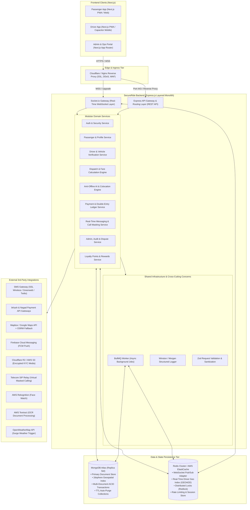
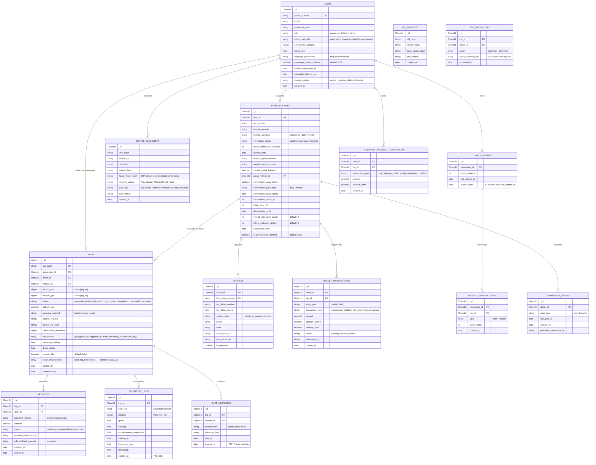
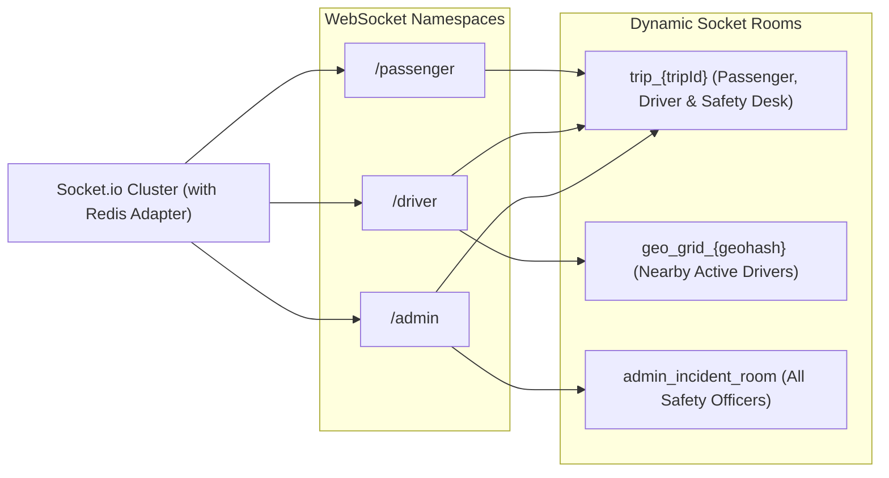
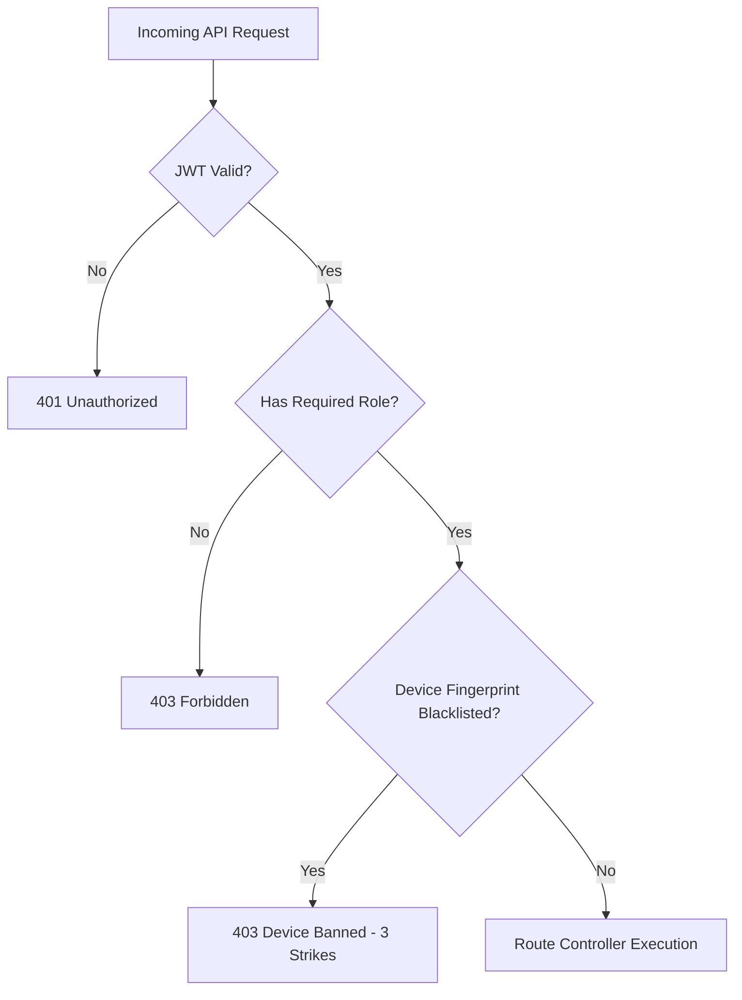
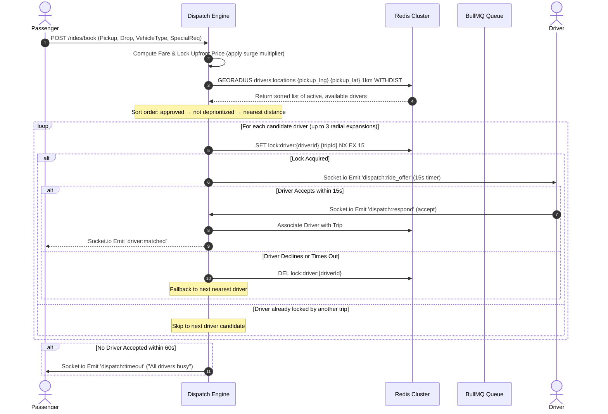
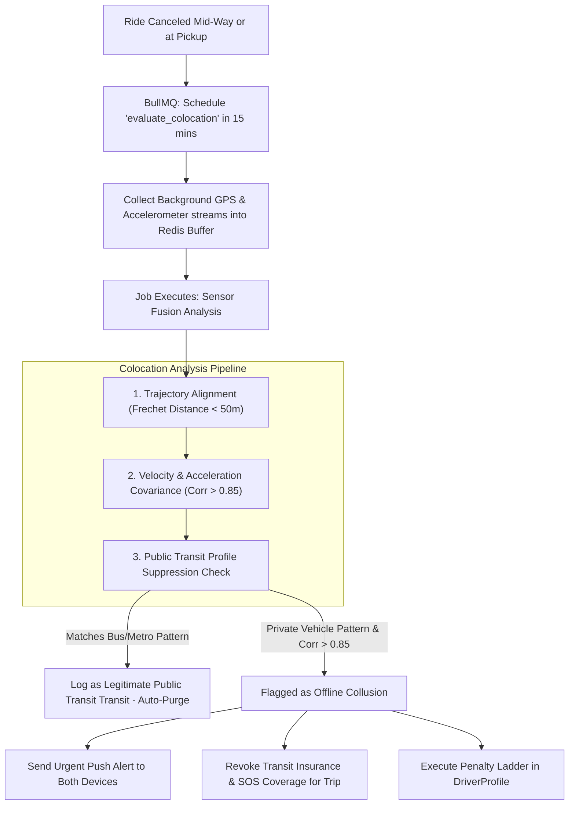
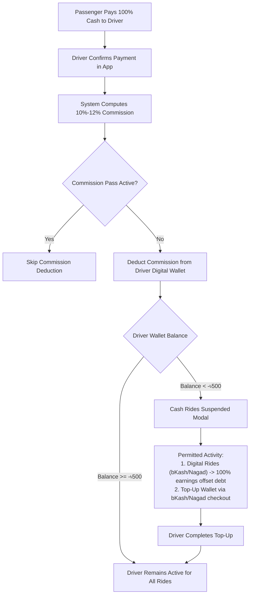
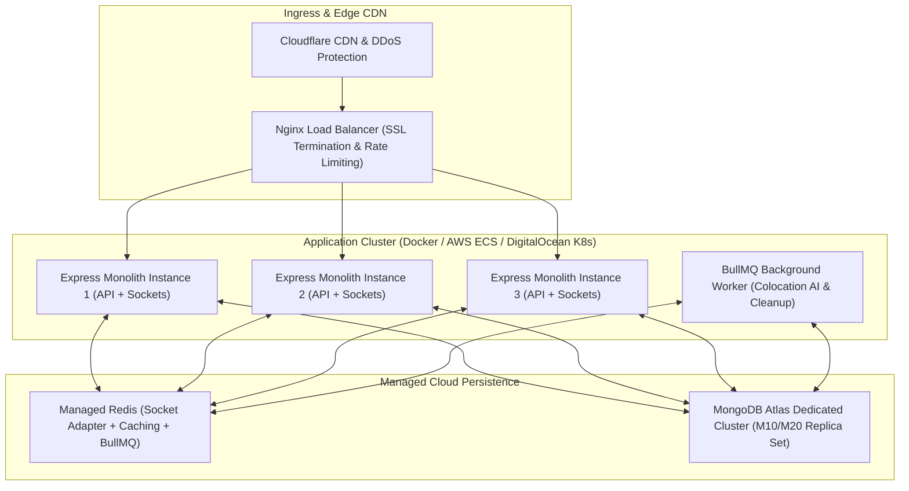

# System Architecture Document — SecureRide
**Project:** SecureRide Platform  
**Document Version:** 2.0 (Gap-Resolved — Production Hardened)  
**Architecture Pattern:** Layered (Modular) Monolith Architecture  
**Core Stack:** Next.js (Frontend) + Express.js / TypeScript (Backend) + MongoDB Atlas (Database) + Redis (Real-Time & Cache)  
**Date:** 2026-10-30  
**Status:** Architecture Specification & Blueprint  

---

## 1. Architecture Overview & High-Level Topology

SecureRide is built as a **Layered Modular Monolith**. While microservices add operational overhead (distributed transactions, network latency, complex tracing) that can cripple early-stage ride-sharing startups, a spaghetti monolith creates tight coupling. A **Layered Monolith** provides the optimal balance: a single deployable artifact partitioned into strict horizontal layers (Presentation, Controller, Service, Data Access) and isolated vertical business domains (Auth, Rides, Drivers, Payments, Telemetry, Communication).

### High-Level Topology Diagram



---

## 2. Layered Monolith Structure & Clean Architecture Rules

The backend codebase is structured into clear horizontal layers. Communication flows strictly downwards:
$$\text{Controllers} \longrightarrow \text{Services (Business Logic)} \longrightarrow \text{Repositories / DAL} \longrightarrow \text{Mongoose Models} \longrightarrow \text{Database}$$

### Strict Architecture Invariants:
1. **Controllers contain ZERO business logic:** They only extract request parameters, trigger Zod validation, call the appropriate Service method, and format the HTTP response.
2. **Services contain ALL business logic:** Services orchestrate transactions, calculate fares, apply penalty rules, coordinate background tasks, and trigger events. Services never directly write SQL/MongoDB query strings.
3. **Data Access Layer (DAL / Repositories):** Encapsulates Mongoose queries, geospatial projections, aggregations, and session-bound transactions.
4. **Domain Event Bus:** Cross-module communication (e.g., Ride completed $\rightarrow$ Wallet deducted $\rightarrow$ Push notification sent) occurs via an in-memory Event Emitter or Redis Pub/Sub, preventing circular dependency between services.

### Backend Project Directory Layout (`/server`)

```
server/
├── src/
│   ├── app.ts                  # Express application setup & middleware stack
│   ├── server.ts               # HTTP & Socket.io server bootstrap
│   ├── config/                 # Environment variables, DB connections, Redis config
│   │   ├── env.config.ts
│   │   ├── db.config.ts
│   │   └── redis.config.ts
│   │
│   ├── common/                 # Cross-cutting concerns & shared utilities
│   │   ├── constants/          # Error codes, user roles, vehicle categories
│   │   ├── errors/             # Custom ApiError, NotFoundError, UnauthorizedError
│   │   ├── middlewares/        # auth.middleware, role.middleware, rateLimiter, errorHandler
│   │   ├── utils/              # jwt.util, totp.util, crypto.util, logger.util
│   │   └── validators/         # Common Zod validation schemas
│   │
│   ├── modules/                # Vertical Feature Domains (Independent Units)
│   │   ├── auth/
│   │   │   ├── auth.controller.ts
│   │   │   ├── auth.service.ts
│   │   │   ├── auth.repository.ts
│   │   │   ├── auth.validation.ts
│   │   │   └── auth.types.ts
│   │   │
│   │   ├── passenger/
│   │   ├── driver/             # KYC, document validation, vehicle management, commission_pass endpoint
│   │   ├── dispatch/           # Radial search, matching, fare formula, Redis mutex
│   │   ├── trip/               # Lifecycle (start, OTP, cancel, complete, route detour)
│   │   ├── telemetry/          # Anti-Offline AI, GPS tracking, colocation algorithm
│   │   ├── payment/            # bKash, Nagad, Cash commission, double-entry wallet
│   │   ├── chat/               # WebSocket messaging, masked telephony relay
│   │   ├── notification/       # Multi-channel push (FCM) & SMS dispatch
│   │   ├── loyalty/            # Loyalty points earning, redemption, balance management
│   │   └── admin/              # Review queue, ban management, pricing config
│   │
│   ├── models/                 # Mongoose Schemas & TypeScript Interfaces (All 15 Collections)
│   │   ├── user.model.ts
│   │   ├── driverProfile.model.ts
│   │   ├── vehicle.model.ts
│   │   ├── trip.model.ts
│   │   ├── payment.model.ts
│   │   ├── walletTransaction.model.ts
│   │   ├── passengerWalletTransaction.model.ts
│   │   ├── deviceBlacklist.model.ts
│   │   ├── nidBlacklist.model.ts
│   │   ├── sosAuditLog.model.ts
│   │   ├── telemetryLog.model.ts
│   │   ├── chatMessage.model.ts
│   │   ├── loyaltyPoints.model.ts
│   │   ├── loyaltyTransaction.model.ts
│   │   └── commissionPass.model.ts
│   │
│   ├── jobs/                   # BullMQ Background Job Processors
│   │   ├── antiOfflineWorker.ts
│   │   ├── searchTimeoutWorker.ts
│   │   ├── paymentReconciliationWorker.ts
│   │   ├── surgeCalculationWorker.ts
│   │   ├── cancellationRateWorker.ts
│   │   ├── detourRefundWorker.ts
│   │   ├── accountDeletionWorker.ts
│   │   ├── insurancePolicyWorker.ts
│   │   ├── loyaltyPointsWorker.ts
│   │   └── taxTokenExpiryWorker.ts
│   │
│   └── websocket/              # Socket.io handlers & namespace routing
│       ├── socketServer.ts
│       ├── handlers/
│       │   ├── location.handler.ts
│       │   ├── dispatch.handler.ts
│       │   └── chat.handler.ts
│       └── middlewares/
│           └── socketAuth.middleware.ts
```

---

## 3. Frontend Architecture (Next.js 14+ App Router)

The frontend is implemented using **Next.js (App Router)**. A unified repository or dual-app setup (Passenger & Driver Web/PWA + Admin Portal) maximizes code reuse (shared UI components, TypeScript types, validation schemas, and WebSocket clients).

### Key Architectural Choices for Frontend:
1. **Rendering Strategy:**
   - **Static & SSR:** Landing pages, terms, legal disclosures, and marketing screens rendered on server for SEO and instant loading.
   - **Client-Side (CSR) Hydration:** Booking screen, live map, driver HUD, live chat, and telemetry tracking utilize client components (`"use client"`) with dynamic imports to avoid SSR issues with Leaflet/Mapbox maps.
2. **State Management:**
   - **Zustand:** Lightweight, high-performance global store for user sessions, active ride state, driver online status, and incoming request modals.
   - **TanStack Query (React Query):** Server-state caching, automatic background refetching for ride history, wallet balances, and admin review queues.
3. **PWA & Mobile Hardware Access:**
   - Configured with `@ducanh2912/next-pwa` for service-worker caching, offline fallback screens, and "Add to Home Screen" installation on Android & iOS.
   - Native device APIs accessed via standard web standards (`navigator.geolocation.watchPosition`, `navigator.mediaDevices.getUserMedia`, `Notification API`).
   - For drivers requiring background location persistence when screen is locked, the Next.js driver web client is wrapped with **Capacitor.js** to run native background location foreground services on Android.
4. **Real-Time Client Architecture:**
   - Singleton Socket.io client initialized upon authentication with automatic exponential-backoff reconnects.
   - Local state cache in `indexedDB` (via `idb-keyval`) for offline telemetry buffering if connection drops mid-route.
5. **Internationalization (i18n):**
   - **Library:** `next-intl` for Bangla (bn) / English (en) language toggle.
   - **Translation files:** `/client/src/messages/bn.json` and `/client/src/messages/en.json`.
   - **Language preference:** Stored in `USERS.language_preference: enum ['bn', 'en']`; default `'bn'`.
   - **FCM push payloads:** Backend fetches recipient's `language_preference` and sends localized `title`/`body` in the correct language.
6. **Offline Storage Strategy:**
   - **Passenger App (Web PWA):** `IndexedDB` via `idb-keyval` for offline state caching (booking context, last known location).
   - **Driver App (Capacitor native):** `@capacitor-community/sqlite` (encrypted SQLite) for offline GPS telemetry buffering — survives app backgrounding on Android OEMs (Xiaomi MIUI, Samsung OneUI). Sync endpoint: `POST /telemetry/sync-batch` accepts array of buffered GPS points with timestamps.

### Frontend Project Directory Layout (`/client`)

```
client/
├── src/
│   ├── app/                    # Next.js App Router Structure
│   │   ├── (auth)/             # Auth routes (login, register, verify-otp)
│   │   ├── (passenger)/        # /dashboard, /book, /trips, /profile, /safety
│   │   ├── (driver)/           # /driver/dashboard, /driver/verify, /driver/wallet
│   │   ├── (admin)/            # /admin/review-queue, /admin/sos, /admin/pricing
│   │   ├── track/              # /track/[tripId] — Public emergency read-only map view (no auth)
│   │   ├── layout.tsx
│   │   └── page.tsx
│   ├── components/             # Reusable Atomic UI Components (Tailwind CSS)
│   │   ├── ui/                 # Buttons, Inputs, Modals, Badges, Tabs
│   │   ├── map/                # Interactive Mapbox/Leaflet wrapper, Pin markers
│   │   ├── booking/            # Vehicle cards, Fare calculator, Special request
│   │   ├── driver/             # Ride HUD, Request countdown, Document uploader
│   │   └── shared/             # LiveChatBox, RatingModal, SOSButton
│   ├── hooks/                  # Custom hooks (useGeolocation, useSocket, useRide)
│   ├── stores/                 # Zustand Stores (authStore, rideStore, socketStore)
│   ├── services/               # Axios API clients with auto-refresh token interceptors
│   ├── lib/                    # Shared validation (Zod), formatters, date utils
│   ├── messages/               # i18n translation files
│   │   ├── bn.json             # Bangla translations
│   │   └── en.json             # English translations
│   └── types/                  # TypeScript interface contracts (matching backend DTOs)
```

---

## 4. Database Architecture & MongoDB Atlas Strategy

MongoDB Atlas is the primary persistence engine. A document database is chosen because ride-hailing entities (trips with dynamic waypoints, multi-step driver document verifications, flexible pricing rules, and unstructured sensor logs) map naturally to JSON schemas.

### 4.1 Key Collections & Schema Design



### 4.2 Database Indexing & Query Optimization Strategy
1. **Geospatial 2dsphere Indexing:**
   - Index on `TRIPS.pickup_geo`: `db.trips.createIndex({ pickup_geo: "2dsphere" })`
   - Real-time driver positioning uses Redis `GEOADD` for ultra-low latency; MongoDB is used for historical trip spatial queries.
2. **Unique Compound Indexes:**
   - Driver uniqueness: `{ phone_number: 1, role: 1 }` (Unique)
   - Vehicle plate uniqueness: `{ brta_plate_number: 1 }` (Unique)
   - Active trip uniqueness: `{ passenger_id: 1, status: 1 }` where status in active states, preventing double-booking.
3. **TTL (Time-To-Live) Auto-Purge Indexes:**
   - Non-violating post-cancellation telemetry logs must be purged after 48 hours for privacy compliance:
     `db.telemetry_logs.createIndex({ expires_at: 1 }, { expireAfterSeconds: 0 })`
   - `CHAT_MESSAGES` TTL: `db.chat_messages.createIndex({ expires_at: 1 }, { expireAfterSeconds: 0 })` — purged 7 days after trip completion.
4. **Multi-Document ACID Transactions:**
   - Handled via Mongoose `session`:
     - Driver Commission Deductions: Deducting commission from Driver Wallet and creating an immutable `WalletTransaction` audit record executes inside a single MongoDB transaction session.
     - Fare adjustments or refund credits execute with atomic rollback on failure.

---

## 5. API Architecture, Protocols & Real-Time Communications

A ride-sharing system cannot rely on REST alone; it requires a hybrid communication strategy:

| Protocol | Usage / Purpose | Technology | Latency Target |
|---|---|---|---|
| **REST (JSON over HTTPS)** | Onboarding, Auth, KYC document upload, Fare quotation, Profile, Admin management | Express.js Router + Zod Middleware | $< 300\text{ms}$ |
| **WebSocket (WSS)** | Real-time driver GPS tracking, Trip status transitions, In-app Live Chat, Dispatch alerts | Socket.io with Redis Adapter | $< 50\text{ms}$ |
| **Server-Sent Events (SSE)** | Optional lightweight fallback for one-way search countdowns and admin live trip monitors | Express SSE endpoint | $< 100\text{ms}$ |
| **SIP / VoIP Relay** | Masked virtual phone calls between passenger and driver | Telecom SIP Provider API / WebRTC | Real-time audio |

### 5.1 Real-Time WebSocket Channel & Namespace Architecture

Socket.io runs with three isolated namespaces to avoid message collision and maintain security boundaries:



### 5.2 Key Real-Time Event Contracts

| Event Name | Direction | Payload Schema | Description |
|---|---|---|---|
| `driver:location_update` | Driver $\rightarrow$ Server | `{ driverId, lat, lng, heading, speed }` | Emitted every 3 seconds while online. Server updates Redis `GEOADD`. |
| `dispatch:ride_offer` | Server $\rightarrow$ Driver | `{ tripId, fare, distance, pickupAddress, specialRequest, ttl: 15 }` | Pushed to target driver during radial search. |
| `dispatch:respond` | Driver $\rightarrow$ Server | `{ tripId, decision: 'accept' \| 'decline' }` | Driver response. If accepted, Redis mutex claims the trip. |
| `trip:status_change` | Server $\rightarrow$ Both | `{ tripId, status, driverLocation, eta }` | Pushed to both devices on state change (`matched`, `arrived`, `started`). |
| `chat:send_message` | Either $\rightarrow$ Server | `{ tripId, senderId, text, timestamp }` | Live in-app messaging. Broadcast to `trip_{tripId}` room. |
| `safety:sos_trigger` | Either $\rightarrow$ Server | `{ tripId, userId, lat, lng, timestamp }` | Immediate priority broadcast to `/admin` incident desk room. |
| `passenger:sensor_update` | Passenger $\rightarrow$ Server | `{ passengerId, lat, lng, altitude_m, barometer_hpa }` | Emitted every 5 seconds during active driver search phase for flyover elevation heuristic. |

### 5.3 Emergency Tracking URL Service

To support SOS escalation, the system generates a time-limited public tracking URL at SOS trigger time via the notification service:

- **Public Next.js route:** `/track/[tripId]` — read-only map view, no auth required for emergency responders.
- **Emergency JWT:** `jwt.sign({ tripId, role: 'emergency_viewer' }, secret, { expiresIn: '2h' })`
- **Backend route:** `GET /trips/:tripId/public-track?token=JWT` — validates emergency JWT, returns current driver lat/lng.
- **URL format:** `https://secride.bd/track/{tripId}?token={emergency_jwt}`
- Generated at SOS trigger time by notification service; sent to emergency_contacts via SMS.

---

## 6. Authentication, Authorization & Security Architecture

### 6.1 Dual-Tier Authentication Flow
1. **New Users (Passenger/Driver):**
   - Step 1: User submits phone number (`+8801XXXXXXXXX`).
   - Step 2: System generates 6-digit cryptographically secure OTP, stores in Redis with 120s TTL, and dispatches via SMS.
   - Step 3: User submits OTP $\rightarrow$ Backend validates and grants temporary registration token $\rightarrow$ User sets email, password, and profile data.
   - **NID Blacklist Check:** Before OTP is sent, the system hashes the submitted NID and checks the `NID_BLACKLIST` collection. If a match is found, registration is blocked immediately.
2. **Existing Users:**
   - Direct login with Phone Number + Password.
   - Password hashed using **Argon2id** (resistant to GPU brute-forcing).
3. **Session Management (JWT Token Rotation):**
   - **Access Token:** Short-lived (15 minutes), signed with asymmetric private key (RS256), contains `userId`, `role`, and `deviceId`.
   - **Refresh Token:** Long-lived (30 days), stored in MongoDB with device fingerprint, hashed in `httpOnly`, `Secure`, `SameSite=Strict` cookie.
   - Token refresh implements **Refresh Token Rotation**: each use invalidates the old token and issues a new pair. If an already-used refresh token is presented, the entire token family is revoked (anti-theft).

### 6.2 Role-Based Access Control (RBAC) Matrix



- **Roles Supported:**
  - `passenger`: Can book rides, view history, manage profile, trigger SOS.
  - `driver`: Can accept dispatches, update location, manage wallet, add vehicles. Requires `is_approved = true` to receive ride dispatches.
  - `admin_ops`: KYC queue management, dispute resolution, commission configuration.
  - `admin_safety`: Live SOS monitoring, audio playback (SOS recordings), unmask phone numbers, 999 escalation, incident response.
  - `admin_super`: All of the above + financial ledger access, device ban override, pricing configurator, system settings, full audit log access.

- **Admin Sub-Role (`admin_sub_role` field in USERS):**
  - Stored as `enum ['ops', 'safety', 'super']`, nullable for non-admin users.
  - `admin_ops` and `admin_safety` are scoped sub-roles enforced at middleware level via `admin_sub_role` claim in JWT payload.

### 6.3 Security Hardening Specifications
1. **Mock Location & Anti-Tamper Prevention:**
   - Client sends GPS metadata including `isMock: boolean` (via native bridge) and network BSSID.
   - Backend compares speed transitions: location jumps $>120\text{ km/h}$ between 3-second pings are flagged as anomalous.
2. **Virtual Masked Calling Relay:**
   - Drivers and passengers never receive real phone numbers. The client "Call" button dials a central telecom IVR proxy which bridges the call using a temporary virtual session ID bound to the active `tripId`.
3. **Rate Limiting (DDoS & Brute-Force):**
   - Redis-backed sliding window rate limiter:
     - `/auth/send-otp`: Maximum 3 requests per 10 minutes per IP/Phone.
     - `/auth/verify-otp`: Maximum 5 attempts per OTP; failure locks phone for 15 minutes.
     - Public API endpoints: 100 requests per minute per IP.
4. **Google Play Integrity API (Android):**
   - Verdict requested at **app startup** and before each `dispatch:respond` event from a driver.
   - Required minimum verdict: `MEETS_DEVICE_INTEGRITY`.
   - `NO_INTEGRITY` or emulator verdict → Block dispatch capability + flag in admin fraud report.
   - Verdict cached in Redis key `integrity:{deviceId}` with **1-hour TTL** to avoid excessive API calls.
   - Result stored in `DEVICE_BLACKLISTS` collection as `integrity_verdict` field.
5. **Apple DeviceCheck (iOS):**
   - DeviceCheck token sent with each KYC document submission on iOS.
   - Token verified server-side; result stored in `DEVICE_BLACKLISTS.integrity_verdict`.
6. **Active Vehicle Pre-Check Middleware:**
   - **Socket middleware** (`socketAuth.middleware.ts`): Checks that `active_vehicle_id` is set **AND** the vehicle's `is_approved = true` before allowing the driver socket to emit `driver:location_update`. Unauthorized emit attempts are rejected with an error event.
   - **HTTP middleware**: Blocks `PATCH /driver/status/online` if the driver has no active approved vehicle.
   - **Tax token expiry check**: On every `driver:location_update` event, a Redis-cached check (1-hour TTL key `tax_check:{driverId}`) verifies that `tax_token_expiry >= today + 15 days`. If failing → socket disconnected + FCM push notification sent to driver.

### 6.4 Driver Liveness Verification Pipeline

Liveness verification is required during driver KYC onboarding and periodic re-verification, preventing photo spoofing attacks.

#### On-Device Liveness Detection
- **Android:** **Google ML Kit Face Detection** (on-device, free, offline capable)
  - Challenge-response: Randomized sequence from `{ blink_left, blink_right, head_turn_left, head_turn_right, smile }`.
  - 2 challenges per verification session.
  - Confidence threshold: ≥ **0.85** to pass each challenge.
- **iOS:** **ARKit + Vision framework** face landmark detection for equivalent challenge-response liveness verification.

#### Server-Side Face Match
- **Engine:** **AWS Rekognition `CompareFaces`**
- **Flow:** Uploaded selfie (captured after liveness pass) vs NID photo (already on file in Cloudflare R2) are submitted to AWS Rekognition.
- **Similarity threshold:** ≥ **90%** to pass.
- **Failure policy:** If on-device liveness passes but AWS Rekognition face match fails → counted as a **failed verification attempt** (increments `DRIVER_PROFILES.failed_verification_attempts`). Standard lockout ladder applies.

### 6.5 OCR-Assisted KYC Document Processing

All driver KYC documents are processed via **AWS Textract** (structured document parsing) upon upload.

#### Documents Processed & Fields Extracted:
| Document | Fields Extracted |
|---|---|
| NID Card | NID number, full name, date of birth |
| Driving License | License number, expiry date, category/class |
| Tax Token | Token number, expiry date, vehicle registration number |

#### Processing Rules:
- **Confidence ≥ 85%:** Extracted fields auto-populate the admin KYC review form, reducing manual entry.
- **Confidence < 85%:** Document flagged for **manual review** — admin must manually read and enter fields.

#### Cross-Match Validation (in `driver.service.ts`):
- The `license_category` extracted by OCR (from Driving License) is cross-matched against the `vehicle_class` submitted by the driver in their vehicle registration form.
- **Mismatch → Auto-reject:** The KYC application is automatically rejected with reason `"license_category_vehicle_class_mismatch"`. Driver is notified via push and prompted to re-submit with correct documents.

---

## 7. Real-Time Dispatch, Geospatial & Telemetry Architecture

Matching passengers to nearby drivers within 1.5 seconds is the core algorithmic challenge.

### 7.1 Dispatch Matchmaking Algorithm (Redis Geospatial + Distributed Lock)



**Dispatch Sort Order:** The engine sorts available drivers by: `approved` status first → not currently `deprioritized` (cancellation rate penalty) → nearest geographic distance.

### 7.2 Elevation Heuristic (Flyover vs Surface Road)
In urban transit corridors with elevated expressways (e.g., Mayor Hanif Flyover), 2D GPS points overlap ($\Delta d < 20\text{m}$) while physical vertical separation is $>15\text{m}$.
- **Algorithm:**
  $$\text{Separation Score} = w_1 \cdot |\text{Alt}_{\text{passenger}} - \text{Alt}_{\text{driver}}| + w_2 \cdot (1 - \cos(\theta_{\text{heading\_diff}}))$$
- If the altitude difference exceeds $10\text{m}$ and heading vectors diverge without physical ramp connectivity within 200m, the dispatch engine marks the driver as "Unreachable - Vertical Tier Mismatch" and suppresses false arrival triggers.

#### Passenger Sensor Streaming for Elevation Data:
To provide real-time altitude data for the flyover heuristic, the passenger app streams sensor data during the booking search phase:
- **WebSocket event:** `passenger:sensor_update` emitted **every 5 seconds** during active driver search.
- **Payload:** `{ passengerId, lat, lng, altitude_m, barometer_hpa }`
- Both `altitude_m` and `barometer_hpa` are stored in `TELEMETRY_LOGS` (see Section 4.1 schema).

### 7.3 Dynamic Surge Multiplier Engine

**BullMQ Job:** `surgeCalculationWorker.ts` — runs every **5 minutes** per active zone.

#### Surge Trigger Condition:
$$\frac{\text{pending\_booking\_requests\_in\_zone}}{\text{available\_drivers\_in\_zone}} > 1.5$$

#### Surge Multiplier Steps:
| Step | Multiplier | Cap |
|---|---|---|
| Normal | 1.0x | — |
| Low surge | 1.2x | — |
| Medium surge | 1.3x | Microbus maximum |
| High surge | 1.4x | Bike maximum |
| High surge | 1.5x | Car maximum |

#### Weather Surge Floor:
- **OpenWeatherMap API** checked every **10 minutes** per active zone geohash.
- If `weather.rain` is detected for a zone geohash → minimum surge floor set to **1.2x** regardless of demand ratio.

#### Redis Storage:
- Current surge multiplier stored in Redis key: `surge:{zone_geohash}` with **6-minute TTL**.

#### Admin Override:
- `POST /admin/pricing/surge` — sets manual surge level for a zone, bypassing the algorithm until manually cleared via `DELETE /admin/pricing/surge/{zone_geohash}`.

### 7.4 Vehicle Breakdown & Rescue Dispatch

#### Trigger:
Driver calls `POST /trips/:tripId/breakdown` — marks trip as interrupted.

#### Fare Proration:
$$\text{prorated\_fare} = \frac{\text{km\_covered}}{\text{total\_booked\_km}} \times \text{upfront\_fare}$$

The prorated fare is charged to the passenger for the portion of journey completed.

#### Rescue Trip Creation:
- System auto-creates a new rescue trip: same passenger, same original dropoff, flagged `rescue_ride: true`.
- Rescue fare = `standard_fare × 0.85` (discounted rescue rate).

#### Rescue Dispatch Mode:
- **Simultaneous broadcast** to ALL available nearby drivers (no sequential radial expansion — priority broadcast mode).
- The driver who triggered the breakdown is **excluded** from the rescue dispatch pool.

### 7.5 GPS Breadcrumb Trail & Detour Refund System

#### Breadcrumb Collection:
- `TRIPS.route_breadcrumbs` stores GPS points sampled every **10 seconds** during active trip (`in_progress` status): `[{ lat, lng, timestamp }]`.

#### Detour Refund Processing (`detourRefundWorker.ts`):
- **Trigger:** Passenger submits "Report Detour" via app after trip completion.
- **Process:**
  1. Worker fetches `route_breadcrumbs` from the trip document.
  2. Calls OSRM route API with pickup → dropoff to calculate optimal route distance.
  3. If `actual_distance > optimal_distance × 1.25` → detour confirmed.
  4. Refund amount credited to passenger wallet (`PASSENGER_WALLET_TRANSACTIONS`).
- **Trigger mechanism:** BullMQ job enqueued immediately when passenger submits detour report.

---

## 8. Anti-Offline AI & Background Worker Engine

The Anti-Offline AI Engine is SecureRide's core financial and safety protection mechanism.

### 8.1 Post-Cancellation Spatio-Temporal Colocation Heuristic

When a ride is canceled mid-route or post-arrival, the system launches a background monitoring daemon for 15 minutes on both devices.



### 8.2 Public Transit False-Positive Suppression Logic
To prevent penalizing passengers and drivers who coincidentally board the same public bus or Dhaka Metro Rail after a canceled trip:
1. **Transit Corridor Mask:** GPS trajectories are cross-referenced with pre-mapped public transit routes (Metro Rail line, bus routes).
2. **Stopping Cadence:** Public transit vehicles stop at fixed station geofences for 30–60 seconds.
3. **Multi-Commuter Density:** If $>5$ active app users exhibit the exact same vector along a transit corridor, the system classifies the journey as public transportation and suppresses penalty execution.

### 8.3 Safety Infrastructure — SOS Audio Recording

When an SOS event is triggered, the passenger app begins recording ambient audio for safety evidence.

#### Audio Specification:
- **Format:** AAC/Opus codec, maximum **30-minute** recording per SOS event.
- **Storage:** Encrypted **Cloudflare R2** bucket, folder path: `sos-audio/{tripId}/{timestamp}.aac`.
- **Access Control:** Restricted to `admin_safety` role **only** via signed pre-authorized URL with **15-minute expiry**.
- **Retention Policy:**
  - Minimum **90 days** retention for all SOS recordings.
  - Extended to **1 year** if `incident_status = 'legal_case_opened'`.
- **Audit Logging:** Every playback action by an admin is logged in the `SOS_AUDIT_LOGS` collection (see Section 4.1).

---

## 9. Payment, Ledger & Commission Architecture

### 9.1 Double-Entry Financial Ledger
To ensure auditability, financial transactions are never recorded as simple balance overrides. The system utilizes an **immutable append-only ledger**:
$$\text{Current Balance} = \sum (\text{Credits}) - \sum (\text{Debits})$$

Every completed ride creates two ledger entries:
1. **Driver Trip Credit:** Full gross fare credited to Driver account.
2. **Platform Commission Debit:** 10%–12% platform fee debited from Driver account.

#### Zero-Commission Pass Logic (in `payment.service.ts`):
Before calculating commission on any trip, `payment.service.ts` checks the driver's `commission_pass_active` field and `commission_pass_expiry`. If a valid pass is active, commission deduction is skipped for that transaction. Pass management is handled via the `commission_pass` endpoint in the driver module.

### 9.2 Cash Ride Commission Recovery & Negative Balance Protection



#### Cash Shortage Credit (Passenger Wallet):
- `POST /trips/:tripId/cash-change` — driver inputs the amount of cash received from passenger.
- System calculates difference and credits shortfall to `USERS.passenger_wallet_balance` via a `PASSENGER_WALLET_TRANSACTIONS` ledger entry with `transaction_type: 'cash_change_credit'`.

### 9.3 Payment Gateway (bKash & Nagad) Integration Flow
- **Direct Checkout API:** Tokenized payment initialization $\rightarrow$ Passenger redirects to MFS webview/PIN prompt $\rightarrow$ Callback webhook verified using HMAC signature $\rightarrow$ Asynchronous status query to prevent dropped callbacks.
- **Two-Phase Reconciliation Worker:** A BullMQ background worker queries the MFS gateway for any transaction lingering in `pending` state for $>2$ minutes, ensuring zero stranded funds.

### 9.4 Cancellation Rate Tracking & Driver Deprioritization

**BullMQ daily cron:** `cancellationRateWorker.ts`

- **Tracks** `DRIVER_PROFILES.cancellation_count_7d` and `total_offers_7d` on a rolling 7-day window.
- **Daily cron actions:**
  1. Reset counters for drivers whose 7-day window has expired.
  2. Calculate cancellation rate: `cancellation_count_7d / total_offers_7d`.
  3. If rate > **15%** → set `deprioritized_until = now + 24h`.
- **Effect on dispatch:** Deprioritized drivers appear lower in the dispatch candidate sort order (approved → not deprioritized → nearest distance).

---

## 10. Third-Party Integrations & Services Matrix

| Service Type | Primary Provider | Fallback / Secondary | Purpose & SLA |
|---|---|---|---|
| **SMS Gateway** | SSL Wireless / Greenweb (Local BD) | Twilio Verify API | OTP dispatch & Emergency SOS alerts. SLA $< 10\text{s}$. |
| **Mapping & Routing** | Mapbox Directions & Navigation SDK | OpenStreetMap (OSRM) on self-hosted instance | Route calculation, ETA, and turn-by-turn navigation. |
| **Geocoding & Places** | Google Places API / Barikoi (BD Local) | Mapbox Geocoding | Autocomplete search for pickup and destination addresses. |
| **Object Storage** | Cloudflare R2 / AWS S3 | Encrypted MinIO Instance | Driver NID, License, Tax Token, vehicle photos, and SOS audio recordings. |
| **Push Notifications** | Firebase Cloud Messaging (FCM) | Apple APNs direct | Critical ride updates, arrival alerts, and admin warnings. Payloads localized per `language_preference`. |
| **Telecom Virtual Proxy** | Twilio Voice / Local Telco SIP Trunk | In-App WebRTC Voice | Virtual number masking for passenger-driver phone calls. |
| **Face Verification** | AWS Rekognition CompareFaces | — | Server-side selfie vs NID photo face match. Similarity threshold ≥ 90%. |
| **OCR Document Processing** | AWS Textract | — | Structured extraction of NID, license, and tax token fields during driver KYC. Confidence threshold ≥ 85%. |
| **Weather Data** | OpenWeatherMap API | — | Surge trigger weather detection. Checked every 10 minutes per active zone geohash. |
| **Device Integrity (Android)** | Google Play Integrity API | — | App/device authenticity verdict at startup and before `dispatch:respond`. Cached in Redis 1h. |
| **Device Integrity (iOS)** | Apple DeviceCheck | — | Device token verification on KYC document submissions. |
| **Transit Micro-Insurance** | Green Delta / Pragati Life Insurance API | Redis Queue batch sync (`insurancePolicyWorker.ts`) | Instant per-trip policy certificate issuance & claim dispatch (Module 8). SLA $< 5\text{s}$. |

---

## 11. Error Handling, Resilience & Disaster Recovery

### 11.1 Offline Client-Side Resiliency (Network Dead Zones)
1. **Offline Cryptographic TOTP:**
   - When a ride is booked, the backend generates an HMAC-based TOTP secret seeded by `tripId + salt` and caches it on both devices.
   - If driver arrives in an underground parking garage with zero cell reception, the driver inputs the passenger's 4-digit code. The driver app verifies the cryptographic signature **locally without hitting the network**, starts the trip meter, and logs GPS points to local `indexedDB`/SQLite.
2. **Local Telemetry Queuing:**
   - If network connectivity drops to 2G or disconnects, the mobile client buffers sensor pings locally. Upon network re-establishment, buffered points sync in a single bulk batch (`POST /telemetry/sync-batch`).
   - **Driver App (Capacitor):** Uses `@capacitor-community/sqlite` (encrypted SQLite) for offline GPS telemetry buffering, designed to survive app backgrounding on Android OEMs (Xiaomi MIUI, Samsung OneUI).
   - **Passenger App (Web PWA):** Uses `IndexedDB` via `idb-keyval` for offline state caching.

### 11.2 Graceful Payment Degradation
- If bKash or Nagad APIs return $>15\%$ error rates during a rolling 3-minute window:
  1. Circuit breaker trips open.
  2. The booking UI automatically disables digital payment radio buttons with a polite notification: *"bKash/Nagad networks currently experiencing downtime. Cash rides active."*
  3. No failed transactions or stuck authorizations are introduced.

### 11.3 High Availability & Disaster Recovery
- **Database Failover:** MongoDB Atlas 3-node replica set with automated primary election ($< 5\text{s}$ failover).
- **Redis Multi-AZ:** Redis Cluster with master-replica replication and automated sentinel failover.
- **RPO (Recovery Point Objective):** $< 1\text{ minute}$ via continuous oplog backups.
- **RTO (Recovery Time Objective):** $< 15\text{ minutes}$ via automated container redeployment on standby cluster.

### 11.4 Account Deletion Data Lifecycle

**BullMQ daily cron:** `accountDeletionWorker.ts`

Users may request account deletion, which initiates a grace-period lifecycle:
1. On request: Set `deletion_requested_at = now`, `scheduled_deletion_at = now + 30 days`, `deletion_status = 'pending_deletion'`.
2. **Daily cron:** Finds all accounts where `scheduled_deletion_at <= now` AND `deletion_status = 'pending_deletion'`.
3. **PII Nullification:** Nullifies the following fields: `name`, `email`, `phone`, `profile_photo`, `emergency_contacts`.
4. **Financial records retained:** `WALLET_TRANSACTIONS`, `PAYMENTS`, `TRIP` records retained for regulatory compliance (financial audit trail).
5. Set `deletion_status = 'deleted'`.

---

## 12. Deployment, Infrastructure & Scalability Strategy

### 12.1 Containerized Monolith Deployment Model



### 12.2 Sizing & Scaling Parameters (MVP Launch Target)
- **Target Concurrency:** 5,000 simultaneous active rides and 25,000 connected WebSockets.
- **Compute Sizing:**
  - 3x Express API/Socket Instances (2 vCPU, 4GB RAM each). Auto-scaling threshold at 70% CPU.
  - 2x BullMQ Background Workers (2 vCPU, 2GB RAM each).
  - MongoDB Atlas M20 Instance (3-node replica set, 4GB RAM, dedicated storage).
  - Redis Cluster: 2-node primary/replica with 4GB memory.
- **Build & CI/CD Pipeline:**
  - GitHub Actions running linting, Zod schema validation, unit tests, and Docker container builds.
  - Zero-downtime rolling deployments via Kubernetes / Docker Swarm rolling updates.

---

## 13. Summary Recommendation & Implementation Roadmap

| Phase | Milestone Focus | Deliverables |
|---|---|---|
| **Sprint 1 (Foundations)** | Core Monolith & Identity | Express + TypeScript boilerplate, MongoDB schemas, dual-tier auth, SMS OTP integration, Argon2/JWT session rotation. |
| **Sprint 2 (Driver KYC & Verification)** | Compliance & Onboarding | Step 1 & Step 2 document upload, Cloudflare R2 storage, Admin Review Queue, 3-strike device ban logic, AWS Textract OCR integration, AWS Rekognition face match, liveness detection SDK. |
| **Sprint 3 (Real-Time Dispatch & Booking)** | Geospatial & Socket.io | Redis GEO index, radial dispatch engine, upfront fare formula, Redis Redlock assignment, Socket.io channels, Play Integrity API integration, surge calculation worker. |
| **Sprint 4 (Trip Execution & Telemetry)** | Safety & Metering | Offline TOTP pickup verification, live turn-by-turn tracking, Live Chat, geofence deviation detection, SOS escalation, SOS audio recording, emergency tracking URL, GPS breadcrumb trail. |
| **Sprint 5 (Payments & Anti-Offline AI)** | Revenue & Integrity | bKash & Nagad checkout, Double-entry wallet ledger, BullMQ colocation analysis heuristics, public transit suppression, loyalty points system, commission pass, passenger wallet. |
| **Sprint 6 (Testing & Production Launch)** | Hardening & Audit | End-to-end load testing (5,000 virtual rides), penetration testing, Play Store/App Store background location consent audit, i18n Bangla/English validation, full RBAC sub-role audit. |
