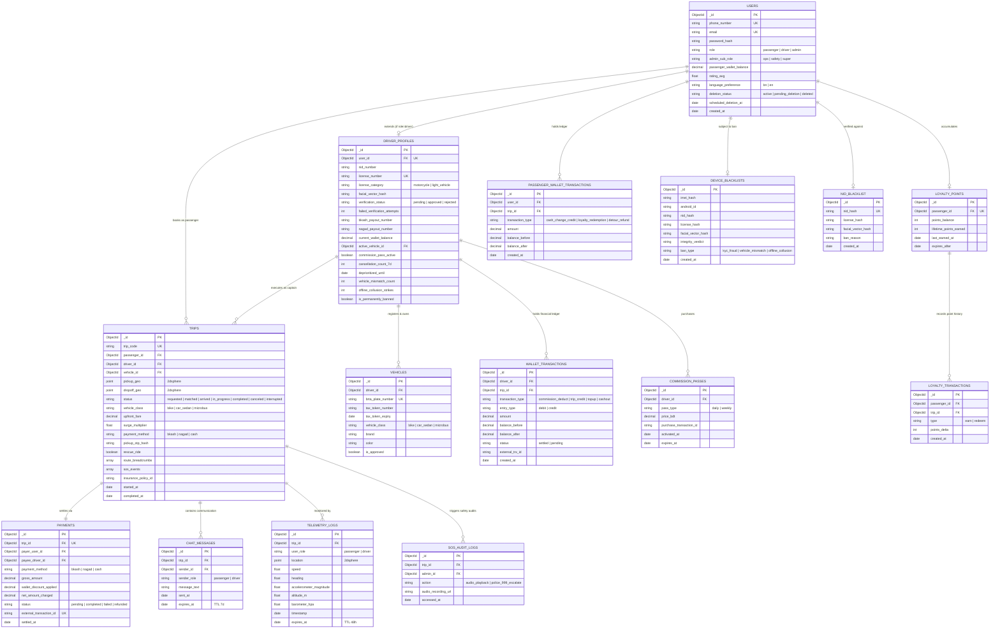

# Database Specification & Data Architecture Document — SecureRide Platform
**Document Version:** 1.0 (Production Enterprise Architecture Specification)  
**Database Technology:** MongoDB Atlas (Dedicated Replica Set) + Redis Cluster (In-Memory Real-Time Tier)  
**Document Object Mapper:** Mongoose 8+ with TypeScript Interfaces  
**Compliance Standards:** Bangladesh Digital Security Act 2018, Apple App Store Guidelines 5.1.1(v)  
**Last Updated:** 2026-10-30  
**Status:** Approved Technical Architecture Artifact  

---

## Table of Contents
1. [Collection List](#1-collection-list)
2. [Data Schemas & Field Definitions](#2-data-schemas--field-definitions)
3. [Entity Relationships & Data Modeling Strategy](#3-entity-relationships--data-modeling-strategy)
4. [Indexing Strategy & Optimization](#4-indexing-strategy--optimization)
5. [Database-Level Schema Validation ($jsonSchema)](#5-database-level-schema-validation-jsonschema)
6. [Analytical Aggregation Pipelines](#6-analytical-aggregation-pipelines)
7. [Multi-Document ACID Transactions](#7-multi-document-acid-transactions)
8. [Production Sample Data (Dhaka Context)](#8-production-sample-data-dhaka-context)
9. [TypeScript Mongoose Schemas & Models](#9-typescript-mongoose-schemas--models)
10. [Entity-Relationship Diagram (ERD)](#10-entity-relationship-diagram-erd)

---

## 1. Collection List

The SecureRide persistence tier is structured into fifteen (15) core MongoDB collections, supported by in-memory Redis geospatial structures for low-latency operational state.

| # | Collection Name | Physical Storage Engine | Purpose & Domain Scope | Primary Key | Key Invariants |
|:---|:---|:---|:---|:---|:---|
| **1** | `users` | MongoDB Atlas | Master identities, authentication digests, roles, wallets, and account deletion states. | `_id (ObjectId)` | Unique `phone_number`; single account per identity. |
| **2** | `driver_profiles` | MongoDB Atlas | Regulatory verification, KYC vetting records, payout accounts, cancellation rates, suspension flags. | `_id (ObjectId)` | 1:1 relationship with `users` (where `role = 'driver'`). |
| **3** | `vehicles` | MongoDB Atlas | Fleet registry, BRTA registration plates, tax token validity, vehicle classification. | `_id (ObjectId)` | Unique `brta_plate_number`; 1:N with `driver_profiles`. |
| **4** | `trips` | MongoDB Atlas | Trip state machine, spatial waypoints, locked upfront fares, breadcrumbs, safety telemetry. | `_id (ObjectId)` | Unique human-readable `trip_code`; immutable on completion. |
| **5** | `payments` | MongoDB Atlas | Payment transaction records across bKash, Nagad, and Cash rails. | `_id (ObjectId)` | 1:1 with `trips`; tracks gateway callbacks and refunds. |
| **6** | `wallet_transactions` | MongoDB Atlas | Double-entry ledger recording driver wallet credits, commission debits, and payouts. | `_id (ObjectId)` | Immutable append-only financial ledger. |
| **7** | `passenger_wallet_transactions` | MongoDB Atlas | Passenger digital wallet ledger tracking cash change shortage credits and loyalty redemptions. | `_id (ObjectId)` | Immutable append-only passenger financial ledger. |
| **8** | `telemetry_logs` | MongoDB Atlas | Spatio-temporal sensor logs (GNSS, accelerometer, altitude, barometer). | `_id (ObjectId)` | TTL index: purged after 48 hours for non-fraud rides. |
| **9** | `device_blacklists` | MongoDB Atlas | 3-strike hardware bans combining IMEI/Android ID, NID hash, and biometric facial vector hash. | `_id (ObjectId)` | Permanent multi-factor device fingerprint blacklist. |
| **10**| `nid_blacklist` | MongoDB Atlas | Permanent legal blacklist of NIDs, driving licenses, and facial vectors. | `_id (ObjectId)` | Checked prior to sending registration SMS OTP. |
| **11**| `sos_audit_logs` | MongoDB Atlas | Auditable access logs for emergency SOS events and ambient audio playbacks. | `_id (ObjectId)` | Immutable security audit register. |
| **12**| `chat_messages` | MongoDB Atlas | In-app WebSocket live chat records between matched drivers and passengers. | `_id (ObjectId)` | TTL index: auto-purged 7 days post-trip completion. |
| **13**| `loyalty_points` | MongoDB Atlas | Passenger rewards balance accumulated from digital ride bookings. | `_id (ObjectId)` | 1:1 with `users` (passenger); 12-month inactivity expiry. |
| **14**| `loyalty_transactions` | MongoDB Atlas | Ledger recording point earnings (1 pt / ৳10) and discount redemptions. | `_id (ObjectId)` | Immutable points movement audit trail. |
| **15**| `commission_passes` | MongoDB Atlas | Driver "Pro Captain" subscription passes (Daily ৳99 / Weekly ৳599). | `_id (ObjectId)` | 1:N with `driver_profiles`; waives commission when active. |
| **—**| `redis:driver_locations` | Redis In-Memory | Real-time driver spatial index powered by `GEOADD` and `GEORADIUS`. | `driverId` | Volatile real-time geospatial coordinate pool (TTL: 10s). |
| **—**| `redis:redlock_mutex` | Redis In-Memory | Distributed lock preventing race conditions during 15s driver offer dispatch. | `lock:driver:{id}`| 15-second TTL distributed mutual exclusion mutex. |

---

## 2. Data Schemas & Field Definitions

### 2.1 Collection: `users`
Represents all system actors (Passengers, Drivers, and Platform Administrators).

```json
{
  "_id": "ObjectId — Primary Key",
  "phone_number": "String — Normalized E.164 (+8801XXXXXXXXX) [Unique, Indexed]",
  "email": "String — RFC 5322 Compliant Email [Nullable, Unique Sparse, Lowercase]",
  "password_hash": "String — Argon2id Cryptographic Password Hash",
  "role": "String — Enum: ['passenger', 'driver', 'admin']",
  "admin_sub_role": "String — Enum: ['ops', 'safety', 'super', null] [Default: null]",
  "full_name": "String — User display name (Length: 2-80)",
  "profile_photo_url": "String — Pre-signed Cloudflare R2 / S3 CDN Image URL [Nullable]",
  "emergency_contacts": [
    {
      "name": "String — Contact name",
      "phone_number": "String — Valid Bangladeshi phone number",
      "relationship": "String — e.g., 'Spouse', 'Parent', 'Sibling', 'Friend'"
    }
  ],
  "saved_addresses": [
    {
      "label": "String — 'Home' | 'Work' | 'Other'",
      "address_text": "String — Formatted location string",
      "location": {
        "type": "String — 'Point'",
        "coordinates": "[Number, Number] — [Longitude, Latitude]"
      }
    }
  ],
  "passenger_wallet_balance": "Decimal128 — Available in-app cash shortage / refund balance [Default: 0.00]",
  "rating_avg": "Double — Rolling bilateral rating score (Range: 1.00 - 5.00) [Default: 5.00]",
  "total_ratings_count": "Int32 — Total ratings received [Default: 0]",
  "language_preference": "String — Enum: ['bn', 'en'] [Default: 'bn']",
  "fcm_tokens": ["String — Active Firebase Cloud Messaging device registration tokens"],
  "deletion_status": "String — Enum: ['active', 'pending_deletion', 'deleted'] [Default: 'active']",
  "deletion_requested_at": "Date — Timestamp when deletion was initiated [Nullable]",
  "scheduled_deletion_at": "Date — Timestamp when PII will be purged (requested_at + 30 days) [Nullable]",
  "created_at": "Date — Timestamp of account creation",
  "updated_at": "Date — Timestamp of last document modification"
}
```

### 2.2 Collection: `driver_profiles`
Maintains operational compliance, legal documentation, payout routing, and penalty tracking for drivers.

```json
{
  "_id": "ObjectId — Primary Key",
  "user_id": "ObjectId — Foreign Key referencing users._id [Unique, Indexed]",
  "nid_number": "String — Smart National Identity Card number (10 or 17 digits) [Indexed]",
  "nid_document_front_url": "String — Cloudflare R2 Encrypted Media URL",
  "nid_document_back_url": "String — Cloudflare R2 Encrypted Media URL",
  "license_number": "String — BRTA Driving License identifier [Unique, Indexed]",
  "license_category": "String — Enum: ['motorcycle', 'light_vehicle'] [Indexed]",
  "license_expiry_date": "Date — Driving license expiration date (Must be in future)",
  "license_document_url": "String — Cloudflare R2 Encrypted Media URL",
  "live_selfie_url": "String — Cloudflare R2 Encrypted Media URL",
  "facial_vector_hash": "String — SHA-256 Digest of Biometric Facial Embedding (64 chars) [Indexed]",
  "verification_status": "String — Enum: ['pending', 'approved', 'rejected'] [Default: 'pending', Indexed]",
  "failed_verification_attempts": "Int32 — Consecutive failed verification counter [Default: 0]",
  "lockout_until": "Date — 1-hour cooldown timestamp following a rejected submission [Nullable]",
  "bkash_payout_number": "String — Mandatory verified bKash mobile wallet number",
  "nagad_payout_number": "String — Mandatory verified Nagad mobile wallet number",
  "current_wallet_balance": "Decimal128 — Net wallet balance (Minimum allowed: -500.00 BDT) [Default: 0.00]",
  "active_vehicle_id": "ObjectId — Foreign Key referencing vehicles._id [Nullable, Indexed]",
  "commission_pass_active": "Boolean — True if valid Pro-Captain pass is active [Default: false]",
  "commission_pass_type": "String — Enum: ['daily', 'weekly', null] [Default: null]",
  "commission_pass_expiry": "Date — Timestamp when active commission pass expires [Nullable]",
  "cancellation_count_7d": "Int32 — Rolling 7-day driver cancellations count [Default: 0]",
  "total_offers_7d": "Int32 — Rolling 7-day ride offers accepted/declined [Default: 0]",
  "deprioritized_until": "Date — Dispatch de-prioritization penalty timestamp (if cancel rate > 15%) [Nullable]",
  "vehicle_mismatch_count": "Int32 — Number of vehicle mismatch violations logged [Default: 0]",
  "offline_collusion_strikes": "Int32 — Cumulative offline collusion penalty count (Warning -> 7d deprioritize -> Ban) [Default: 0]",
  "suspended_until": "Date — Account suspension timestamp (7 days on 1st mismatch) [Nullable]",
  "is_permanently_banned": "Boolean — Permanent platform ban status (on 2nd mismatch / 3-strike) [Default: false]",
  "created_at": "Date — Profile creation timestamp",
  "updated_at": "Date — Profile last updated timestamp"
}
```

### 2.3 Collection: `vehicles`
Maintains legal registration, fitness documentation, and physical specifications of vehicles.

```json
{
  "_id": "ObjectId — Primary Key",
  "driver_id": "ObjectId — Foreign Key referencing driver_profiles._id [Indexed]",
  "brta_plate_number": "String — Official registration (e.g., 'Dhaka Metro-HA 12-3456') [Unique, Indexed]",
  "tax_token_number": "String — BRTA Tax Token identifier",
  "tax_token_expiry": "Date — Tax Token expiry date (Must be >= Today + 15 days) [Indexed]",
  "vehicle_class": "String — Enum: ['bike', 'car_sedan', 'microbus'] [Indexed]",
  "brand": "String — Vehicle manufacturer (e.g., 'Yamaha', 'Toyota', 'Honda')",
  "model_name": "String — Model designation (e.g., 'FZS V3', 'Corolla Axio', 'HiAce')",
  "color": "String — Exterior body color (e.g., 'Metallic Black', 'Pearl White')",
  "front_photo_url": "String — Cloudflare R2 Media URL showing license plate",
  "rear_photo_url": "String — Cloudflare R2 Media URL showing vehicle rear",
  "registration_document_url": "String — Cloudflare R2 Encrypted Media URL",
  "is_approved": "Boolean — Operational approval gate flag [Default: false, Indexed]",
  "created_at": "Date — Vehicle registration timestamp",
  "updated_at": "Date — Vehicle last updated timestamp"
}
```

### 2.4 Collection: `trips`
The central operational document encapsulating the complete lifecycle of a ride.

```json
{
  "_id": "ObjectId — Primary Key",
  "trip_code": "String — Unique alphanumeric trip identifier (e.g., 'TRX-20261030-8901') [Unique, Indexed]",
  "passenger_id": "ObjectId — Foreign Key referencing users._id [Indexed]",
  "driver_id": "ObjectId — Foreign Key referencing driver_profiles._id [Nullable, Indexed]",
  "vehicle_id": "ObjectId — Foreign Key referencing vehicles._id [Nullable, Indexed]",
  "pickup_address": "String — Textual pickup location description",
  "pickup_geo": {
    "type": "String — 'Point'",
    "coordinates": "[Number, Number] — [Longitude, Latitude] [2dsphere Indexed]"
  },
  "dropoff_address": "String — Textual destination location description",
  "dropoff_geo": {
    "type": "String — 'Point'",
    "coordinates": "[Number, Number] — [Longitude, Latitude] [2dsphere Indexed]"
  },
  "status": "String — Enum: ['requested', 'matched', 'arrived', 'in_progress', 'completed', 'canceled', 'interrupted'] [Indexed]",
  "vehicle_class": "String — Enum: ['bike', 'car_sedan', 'microbus']",
  "upfront_fare": "Decimal128 — Guaranteed locked fare in BDT (Computed prior to dispatch)",
  "surge_multiplier": "Double — Dynamic surge multiplier applied (Range: 1.00 - 1.50) [Default: 1.00]",
  "payment_method": "String — Enum: ['bkash', 'nagad', 'cash'] [Indexed]",
  "special_request": "String — Passenger custom notes (Max 150 chars, sanitized) [Nullable]",
  "pickup_otp_hash": "String — Hash of 4-digit pickup code or offline TOTP cryptographic seed",
  "rescue_ride": "Boolean — True if ride is an automated breakdown replacement trip [Default: false]",
  "route_breadcrumbs": [
    {
      "location": {
        "type": "String — 'Point'",
        "coordinates": "[Number, Number] — [Longitude, Latitude]"
      },
      "altitude_m": "Double — Barometric/GPS elevation in meters",
      "speed": "Double — Ground speed in km/h",
      "timestamp": "Date — Sample timestamp (Sampled every 10 seconds)"
    }
  ],
  "cancellation_metadata": {
    "canceled_by": "String — 'passenger' | 'driver' | 'system' | null",
    "reason": "String — Structured cancellation tag",
    "fee_charged": "Decimal128 — Cancellation penalty (৳30 Bike / ৳50 Car / ৳70 Microbus / ৳0)",
    "timestamp": "Date — Cancellation timestamp"
  },
  "sos_events": [
    {
      "triggered_by": "String — 'passenger' | 'driver'",
      "triggered_at": "Date — SOS trigger timestamp",
      "audio_recording_url": "String — Cloudflare R2 audio recording key/URL (sos-audio/{tripId}/{timestamp}.aac) [Nullable]",
      "resolved_at": "Date — Safety incident resolution timestamp [Nullable]",
      "resolution_notes": "String — Admin resolution summary [Nullable]"
    }
  ],
  "insurance_policy_id": "String — Partner policy number (Green Delta / Pragati) [Nullable, Indexed]",
  "passenger_rating": "Int32 — Rating given to driver (Range: 1 - 5) [Nullable]",
  "passenger_review_tags": ["String — e.g., 'Safe Driver', 'Clean Vehicle', 'Polite'"],
  "driver_rating": "Int32 — Rating given to passenger (Range: 1 - 5) [Nullable]",
  "driver_review_tags": ["String — e.g., 'Prompt Arrival', 'Rude Behavior', 'Asked Offline Ride'"],
  "started_at": "Date — Meter start timestamp (OTP verified) [Nullable]",
  "completed_at": "Date — Destination completion timestamp [Nullable]",
  "created_at": "Date — Booking creation timestamp [Indexed]"
}
```

### 2.5 Collection: `payments`
Tracks monetary transactions, gateway webhooks, and refunds.

```json
{
  "_id": "ObjectId — Primary Key",
  "trip_id": "ObjectId — Foreign Key referencing trips._id [Unique, Indexed]",
  "payer_user_id": "ObjectId — Foreign Key referencing users._id [Indexed]",
  "payee_driver_id": "ObjectId — Foreign Key referencing driver_profiles._id [Nullable, Indexed]",
  "payment_method": "String — Enum: ['bkash', 'nagad', 'cash']",
  "gross_amount": "Decimal128 — Total trip fare paid",
  "wallet_discount_applied": "Decimal128 — Passenger wallet credit applied [Default: 0.00]",
  "net_amount_charged": "Decimal128 — Final monetary amount processed",
  "status": "String — Enum: ['pending', 'completed', 'failed', 'refunded'] [Indexed]",
  "external_transaction_id": "String — MFS TrxID returned by bKash/Nagad [Nullable, Indexed]",
  "mfs_callback_payload": "String — Encrypted raw webhook JSON payload [Nullable]",
  "initiated_at": "Date — Timestamp when checkout was initialized",
  "settled_at": "Date — Timestamp when final settlement callback was verified [Nullable]"
}
```

### 2.6 Collection: `wallet_transactions`
The immutable double-entry financial ledger for drivers.

```json
{
  "_id": "ObjectId — Primary Key",
  "driver_id": "ObjectId — Foreign Key referencing driver_profiles._id [Indexed]",
  "trip_id": "ObjectId — Foreign Key referencing trips._id [Nullable, Indexed]",
  "transaction_type": "String — Enum: ['commission_deduct', 'trip_credit', 'topup', 'cashout', 'cancellation_credit'] [Indexed]",
  "entry_type": "String — Enum: ['debit', 'credit']",
  "amount": "Decimal128 — Monetary transaction value (BDT)",
  "balance_before": "Decimal128 — Driver wallet balance prior to mutation",
  "balance_after": "Decimal128 — Driver wallet balance immediately following mutation",
  "status": "String — Enum: ['pending', 'settled', 'failed'] [Default: 'settled', Indexed]",
  "external_trx_id": "String — bKash/Nagad transaction reference for top-up/cash-out [Nullable, Indexed]",
  "notes": "String — Audit explanation (e.g., '10% Platform fee for Trip TRX-9901')",
  "created_at": "Date — Immutable ledger creation timestamp [Indexed]"
}
```

### 2.7 Collection: `passenger_wallet_transactions`
The immutable financial ledger for passenger change balances and refunds.

```json
{
  "_id": "ObjectId — Primary Key",
  "user_id": "ObjectId — Foreign Key referencing users._id [Indexed]",
  "trip_id": "ObjectId — Foreign Key referencing trips._id [Nullable, Indexed]",
  "transaction_type": "String — Enum: ['cash_change_credit', 'loyalty_redemption', 'detour_refund', 'ride_fare_deduction'] [Indexed]",
  "amount": "Decimal128 — Monetary transaction value (BDT)",
  "balance_before": "Decimal128 — Passenger wallet balance prior to mutation",
  "balance_after": "Decimal128 — Passenger wallet balance immediately following mutation",
  "description": "String — Explanation (e.g., 'Change shortage credited by driver for trip TRX-1020')",
  "created_at": "Date — Immutable transaction timestamp [Indexed]"
}
```

### 2.8 Collection: `telemetry_logs`
High-density sensor logs used for colocation verification, detour auditing, and crash detection.

```json
{
  "_id": "ObjectId — Primary Key",
  "trip_id": "ObjectId — Foreign Key referencing trips._id [Indexed]",
  "user_role": "String — Enum: ['passenger', 'driver']",
  "user_id": "ObjectId — Foreign Key referencing users._id",
  "location": {
    "type": "String — 'Point'",
    "coordinates": "[Number, Number] — [Longitude, Latitude] [2dsphere Indexed]"
  },
  "speed": "Double — Speed in km/h",
  "heading": "Double — Bearing in degrees (0 - 360)",
  "accelerometer_magnitude": "Double — Total G-force magnitude sqrt(x^2 + y^2 + z^2)",
  "altitude_m": "Double — GNSS/Barometric elevation in meters",
  "barometer_hpa": "Double — Atmospheric pressure in hPa",
  "is_mock": "Boolean — Flagged true if Android mock location provider is active",
  "timestamp": "Date — Device hardware timestamp",
  "expires_at": "Date — TTL purge timestamp (timestamp + 48 hours) [TTL Indexed]"
}
```

### 2.9 Collection: `device_blacklists`
Maintains hardware fingerprints and multi-factor identifiers of banned devices.

```json
{
  "_id": "ObjectId — Primary Key",
  "imei_hash": "String — Salted SHA-256 hash of hardware IMEI / Serial [Indexed]",
  "android_id": "String — Salted SHA-256 hash of Android ID / iOS IDFV [Indexed]",
  "nid_hash": "String — Salted SHA-256 hash of Smart NID [Indexed]",
  "license_hash": "String — Salted SHA-256 hash of Driving License [Indexed]",
  "facial_vector_hash": "String — SHA-256 hash of biometric face embedding [Indexed]",
  "integrity_verdict": "String — Google Play Integrity verdict (e.g., 'NO_INTEGRITY', 'MEETS_BASIC_INTEGRITY')",
  "ban_type": "String — Enum: ['kyc_fraud', 'vehicle_mismatch', 'offline_collusion', 'device_tamper']",
  "ban_reason": "String — Detailed compliance explanation",
  "banned_by_admin_id": "ObjectId — Foreign Key referencing users._id [Nullable]",
  "created_at": "Date — Ban issuance timestamp [Indexed]"
}
```

### 2.10 Collection: `nid_blacklist`
Dedicated national identity blacklist preventing re-registration before OTP dispatch.

```json
{
  "_id": "ObjectId — Primary Key",
  "nid_hash": "String — Salted SHA-256 hash of National Identity Number [Unique, Indexed]",
  "license_hash": "String — Salted SHA-256 hash of Driving License [Nullable, Indexed]",
  "facial_vector_hash": "String — SHA-256 hash of biometric facial embedding [Nullable, Indexed]",
  "ban_reason": "String — Formal regulatory reason",
  "created_at": "Date — Blacklist creation timestamp"
}
```

### 2.11 Collection: `sos_audit_logs`
Compliance audit log tracking all actions taken on emergency incidents.

```json
{
  "_id": "ObjectId — Primary Key",
  "trip_id": "ObjectId — Foreign Key referencing trips._id [Indexed]",
  "admin_id": "ObjectId — Foreign Key referencing users._id (Safety Officer) [Indexed]",
  "action": "String — Enum: ['audio_playback', 'audio_download', 'police_999_escalate', 'contacts_notified']",
  "audio_recording_url": "String — Cloudflare R2 audio recording key/URL accessed during audit [Nullable]",
  "ip_address": "String — Client IP of the accessing administrator",
  "user_agent": "String — Browser User-Agent header",
  "accessed_at": "Date — Audit access timestamp [Indexed]"
}
```

### 2.12 Collection: `chat_messages`
Temporary persistence layer for in-app messaging.

```json
{
  "_id": "ObjectId — Primary Key",
  "trip_id": "ObjectId — Foreign Key referencing trips._id [Indexed]",
  "sender_id": "ObjectId — Foreign Key referencing users._id",
  "sender_role": "String — Enum: ['passenger', 'driver']",
  "message_text": "String — Sanitized message text (Length: 1 - 500 chars)",
  "sent_at": "Date — Message dispatch timestamp",
  "expires_at": "Date — TTL expiration timestamp (sent_at + 7 days) [TTL Indexed]"
}
```

### 2.13 Collection: `loyalty_points`
Maintains rewards balances for passengers.

```json
{
  "_id": "ObjectId — Primary Key",
  "passenger_id": "ObjectId — Foreign Key referencing users._id [Unique, Indexed]",
  "points_balance": "Int32 — Total redeemable loyalty points [Default: 0]",
  "lifetime_points_earned": "Int32 — Cumulative lifetime points earned [Default: 0]",
  "last_earned_at": "Date — Timestamp of last points credit",
  "expires_after": "Date — Expiry date (last_earned_at + 12 months) [Indexed]",
  "updated_at": "Date — Balance last updated timestamp"
}
```

### 2.14 Collection: `loyalty_transactions`
Auditable movements of loyalty points.

```json
{
  "_id": "ObjectId — Primary Key",
  "passenger_id": "ObjectId — Foreign Key referencing users._id [Indexed]",
  "trip_id": "ObjectId — Foreign Key referencing trips._id [Nullable, Indexed]",
  "type": "String — Enum: ['earn', 'redeem', 'expired'] [Indexed]",
  "points_delta": "Int32 — Points added (+ve) or deducted (-ve)",
  "balance_after": "Int32 — Points balance following mutation",
  "created_at": "Date — Transaction timestamp [Indexed]"
}
```

### 2.15 Collection: `commission_passes`
Tracks purchased zero-commission subscription passes for drivers.

```json
{
  "_id": "ObjectId — Primary Key",
  "driver_id": "ObjectId — Foreign Key referencing driver_profiles._id [Indexed]",
  "pass_type": "String — Enum: ['daily', 'weekly']",
  "price_bdt": "Decimal128 — Cost of pass (৳99 for daily, ৳599 for weekly)",
  "purchase_transaction_id": "String — MFS payment transaction reference",
  "activated_at": "Date — Pass activation timestamp",
  "expires_at": "Date — Expiry timestamp (+24h for daily, +7 days for weekly) [Indexed]",
  "created_at": "Date — Document creation timestamp"
}
```

---

## 3. Entity Relationships & Data Modeling Strategy

### 3.1 Normalization vs. Embedding Architecture Decisions

| Entity Pair | Strategy Chosen | Architectural Rationale & Performance Impact |
|:---|:---:|:---|
| **Users $\leftrightarrow$ Driver Profiles** | **Referenced (1:1)** | Keeps the primary `users` collection lean for high-frequency passenger auth queries ($<10\text{ms}$). Only verified drivers have associated driver profiles. |
| **Driver Profiles $\leftrightarrow$ Vehicles** | **Referenced (1:N)** | Allows drivers to own multiple vehicles (e.g., secondary or replacement vehicle) while pointing `active_vehicle_id` to the currently deployed vehicle. |
| **Trips $\leftrightarrow$ Breadcrumbs** | **Embedded Array (1:N)** | Telemetry points during an active ride are bounded ($< 360\text{ points/hour}$ at 10s sampling). Embedding breadcrumbs inside the trip document allows atomic atomic retrieval for detour arbitration without multi-collection joins. |
| **Trips $\leftrightarrow$ Payments** | **Referenced (1:1)** | Decouples financial audit trails and sensitive MFS callback payloads from high-throughput trip state reads. |
| **Driver Profiles $\leftrightarrow$ Wallet Transactions** | **Referenced (1:N)** | An append-only ledger model requires infinite growth capability. Embedding transactions in a driver document would violate the 16MB BSON limit and cause document fragmentation. |
| **Trips $\leftrightarrow$ Chat Messages** | **Referenced (1:N)** | Messages require an independent TTL auto-purge index (7 days), whereas trip records must be retained for 7 years for statutory compliance. |

### 3.2 Cardinality & Foreign Key Constraint Matrix

```
[users] 1 ─────── 0..1 [driver_profiles]
   │                          │
   │ 1                        │ 1
   │                          │
   │ N                        │ N
[trips] N ─────── 1 ──── [vehicles]
   │
   ├─────── 1 ─────── 1 [payments]
   ├─────── 1 ─────── N [chat_messages]
   └─────── 1 ─────── N [telemetry_logs]

[driver_profiles] 1 ─────── N [wallet_transactions]
[driver_profiles] 1 ─────── N [commission_passes]
[users] 1 ───────────────── N [passenger_wallet_transactions]
[users] 1 ───────────────── 1 [loyalty_points] 1 ─────── N [loyalty_transactions]
```

---

## 4. Indexing Strategy & Optimization

Indexes are engineered to satisfy the platform's strict latency SLA (Fare quote $<1.0\text{s}$, Dispatch matchmaking $<1.5\text{s}$, Chat $<300\text{ms}$).

### 4.1 Index Definitions by Collection

```javascript
// ==================== USERS COLLECTION ====================
db.users.createIndex({ phone_number: 1 }, { unique: true, name: "uniq_phone_number" });
db.users.createIndex({ email: 1 }, { unique: true, sparse: true, name: "uniq_sparse_email" });
db.users.createIndex({ role: 1, admin_sub_role: 1 }, { name: "idx_role_admin_sub_role" });
db.users.createIndex({ scheduled_deletion_at: 1 }, { sparse: true, name: "idx_scheduled_deletion" });

// ==================== DRIVER_PROFILES COLLECTION ====================
db.driver_profiles.createIndex({ user_id: 1 }, { unique: true, name: "uniq_driver_user_id" });
db.driver_profiles.createIndex({ license_number: 1 }, { unique: true, name: "uniq_license_number" });
db.driver_profiles.createIndex({ nid_number: 1 }, { name: "idx_nid_number" });
db.driver_profiles.createIndex({ verification_status: 1 }, { name: "idx_verification_status" });
db.driver_profiles.createIndex({ facial_vector_hash: 1 }, { name: "idx_driver_face_hash" });
db.driver_profiles.createIndex({ active_vehicle_id: 1 }, { name: "idx_active_vehicle_id" });
db.driver_profiles.createIndex({ deprioritized_until: 1 }, { sparse: true, name: "idx_deprioritized" });

// ==================== VEHICLES COLLECTION ====================
db.vehicles.createIndex({ brta_plate_number: 1 }, { unique: true, name: "uniq_brta_plate" });
db.vehicles.createIndex({ driver_id: 1 }, { name: "idx_vehicle_driver_id" });
db.vehicles.createIndex({ is_approved: 1, vehicle_class: 1 }, { name: "idx_approved_vehicle_class" });
db.vehicles.createIndex({ tax_token_expiry: 1 }, { name: "idx_tax_token_expiry" });

// ==================== TRIPS COLLECTION ====================
db.trips.createIndex({ trip_code: 1 }, { unique: true, name: "uniq_trip_code" });
db.trips.createIndex({ pickup_geo: "2dsphere" }, { name: "geo_pickup_location" });
db.trips.createIndex({ passenger_id: 1, status: 1 }, { name: "idx_passenger_active_trip" });
db.trips.createIndex({ driver_id: 1, status: 1 }, { name: "idx_driver_active_trip" });
db.trips.createIndex({ status: 1, created_at: -1 }, { name: "idx_status_created_desc" });
db.trips.createIndex({ insurance_policy_id: 1 }, { sparse: true, name: "idx_insurance_policy" });

// ==================== PAYMENTS COLLECTION ====================
db.payments.createIndex({ trip_id: 1 }, { unique: true, name: "uniq_payment_trip_id" });
db.payments.createIndex({ external_transaction_id: 1 }, { sparse: true, name: "idx_external_trx_id" });
db.payments.createIndex({ status: 1, initiated_at: 1 }, { name: "idx_payment_reconciliation" });

// ==================== WALLET_TRANSACTIONS COLLECTION ====================
db.wallet_transactions.createIndex({ driver_id: 1, created_at: -1 }, { name: "idx_driver_ledger_chronological" });
db.wallet_transactions.createIndex({ external_trx_id: 1 }, { sparse: true, name: "idx_wallet_external_trx" });

// ==================== PASSENGER_WALLET_TRANSACTIONS ====================
db.passenger_wallet_transactions.createIndex({ user_id: 1, created_at: -1 }, { name: "idx_passenger_ledger_chronological" });

// ==================== TELEMETRY_LOGS (TTL AUTO-PURGE) ====================
db.telemetry_logs.createIndex({ expires_at: 1 }, { expireAfterSeconds: 0, name: "ttl_telemetry_48h" });
db.telemetry_logs.createIndex({ trip_id: 1, timestamp: 1 }, { name: "idx_trip_telemetry_series" });
db.telemetry_logs.createIndex({ location: "2dsphere" }, { name: "geo_telemetry_location" });

// ==================== DEVICE_BLACKLISTS COLLECTION ====================
db.device_blacklists.createIndex({ imei_hash: 1 }, { name: "idx_ban_imei" });
db.device_blacklists.createIndex({ android_id: 1 }, { name: "idx_ban_android_id" });
db.device_blacklists.createIndex({ nid_hash: 1 }, { name: "idx_ban_nid" });
db.device_blacklists.createIndex({ facial_vector_hash: 1 }, { name: "idx_ban_face_hash" });

// ==================== NID_BLACKLIST COLLECTION ====================
db.nid_blacklist.createIndex({ nid_hash: 1 }, { unique: true, name: "uniq_banned_nid_hash" });

// ==================== CHAT_MESSAGES (TTL AUTO-PURGE) ====================
db.chat_messages.createIndex({ expires_at: 1 }, { expireAfterSeconds: 0, name: "ttl_chat_7d" });
db.chat_messages.createIndex({ trip_id: 1, sent_at: 1 }, { name: "idx_trip_chat_chronological" });

// ==================== LOYALTY_POINTS COLLECTION ====================
db.loyalty_points.createIndex({ passenger_id: 1 }, { unique: true, name: "uniq_loyalty_passenger" });
db.loyalty_points.createIndex({ expires_after: 1 }, { name: "idx_loyalty_expiry" });

// ==================== COMMISSION_PASSES COLLECTION ====================
db.commission_passes.createIndex({ driver_id: 1, expires_at: -1 }, { name: "idx_driver_active_pass" });
```

---

## 5. Database-Level Schema Validation ($jsonSchema)

To guarantee database integrity independent of application layers, MongoDB native JSON Schema validators are attached to core operational collections.

### 5.1 JSON Schema Validation for `trips`
Enforces valid GeoJSON coordinates, allowed payment methods, and strictly positive upfront fares.

```javascript
db.createCollection("trips", {
  validator: {
    $jsonSchema: {
      bsonType: "object",
      required: [
        "trip_code", "passenger_id", "pickup_address", "pickup_geo",
        "dropoff_address", "dropoff_geo", "status", "vehicle_class",
        "upfront_fare", "payment_method", "created_at"
      ],
      properties: {
        trip_code: {
          bsonType: "string",
          pattern: "^TRX-[0-9]{8}-[A-Za-z0-9]{4}$",
          description: "Must be a valid SecureRide standardized trip code"
        },
        passenger_id: {
          bsonType: "objectId",
          description: "Must reference a valid user _id"
        },
        pickup_geo: {
          bsonType: "object",
          required: ["type", "coordinates"],
          properties: {
            type: { enum: ["Point"] },
            coordinates: {
              bsonType: "array",
              minItems: 2,
              maxItems: 2,
              items: { bsonType: "double" },
              description: "[Longitude, Latitude] in degrees"
            }
          }
        },
        dropoff_geo: {
          bsonType: "object",
          required: ["type", "coordinates"],
          properties: {
            type: { enum: ["Point"] },
            coordinates: {
              bsonType: "array",
              minItems: 2,
              maxItems: 2,
              items: { bsonType: "double" }
            }
          }
        },
        status: {
          enum: ["requested", "matched", "arrived", "in_progress", "completed", "canceled", "interrupted"],
          description: "Can only be one of the permitted lifecycle states"
        },
        vehicle_class: {
          enum: ["bike", "car_sedan", "microbus"]
        },
        upfront_fare: {
          bsonType: "decimal",
          description: "Upfront fare must be positive Decimal128"
        },
        payment_method: {
          enum: ["bkash", "nagad", "cash"]
        },
        special_request: {
          bsonType: ["string", "null"],
          maxLength: 150
        }
      }
    }
  },
  validationLevel: "strict",
  validationAction: "error"
});
```

---

## 6. Analytical Aggregation Pipelines

These production aggregation pipelines power the platform's core algorithmic and anti-fraud engines.

### 6.1 Pipeline 1: Anti-Offline Colocation Trajectory Correlation
Evaluates spatio-temporal co-movement between passenger and driver devices within 15 minutes post-cancellation.

```javascript
const evaluateColocationPipeline = (tripId) => [
  {
    $match: {
      trip_id: new mongoose.Types.ObjectId(tripId)
    }
  },
  {
    $project: {
      user_role: 1,
      location: 1,
      speed: 1,
      accelerometer_magnitude: 1,
      timestamp: 1,
      // Bucket into 15-second time windows
      time_bucket: {
        $toDate: {
          $subtract: [
            { $toLong: "$timestamp" },
            { $mod: [{ $toLong: "$timestamp" }, 15000] }
          ]
        }
      }
    }
  },
  {
    $group: {
      _id: { time_bucket: "$time_bucket", user_role: "$user_role" },
      avg_location: { $first: "$location.coordinates" },
      avg_speed: { $avg: "$speed" },
      avg_accel: { $avg: "$accelerometer_magnitude" }
    }
  },
  {
    $group: {
      _id: "$_id.time_bucket",
      points: {
        $push: {
          role: "$_id.user_role",
          coords: "$avg_location",
          speed: "$avg_speed",
          accel: "$avg_accel"
        }
      }
    }
  },
  // Only keep intervals where both passenger and driver uploaded telemetry
  {
    $match: {
      "points.1": { $exists: true }
    }
  },
  {
    $project: {
      time_bucket: "$_id",
      pass_data: { $arrayElemAt: ["$points", 0] },
      driver_data: { $arrayElemAt: ["$points", 1] }
    }
  }
];
```

### 6.2 Pipeline 2: Rolling 7-Day Driver Cancellation Rate
Calculates driver cancellation percentage over a rolling 7-day period to determine if 24-hour dispatch de-prioritization is triggered ($>15\%$).

```javascript
const driverCancellationRatePipeline = (driverProfileId) => [
  {
    $match: {
      driver_id: new mongoose.Types.ObjectId(driverProfileId),
      created_at: { $gte: new Date(Date.now() - 7 * 24 * 60 * 60 * 1000) }
    }
  },
  {
    $group: {
      _id: "$driver_id",
      total_trips_assigned: { $sum: 1 },
      driver_canceled_trips: {
        $sum: {
          $cond: [
            { $eq: ["$cancellation_metadata.canceled_by", "driver"] },
            1,
            0
          ]
        }
      }
    }
  },
  {
    $project: {
      driver_id: "$_id",
      total_trips_assigned: 1,
      driver_canceled_trips: 1,
      cancellation_rate_percentage: {
        $multiply: [
          { $divide: ["$driver_canceled_trips", { $max: ["$total_trips_assigned", 1] }] },
          100
        ]
      },
      should_deprioritize: {
        $gt: [
          { $divide: ["$driver_canceled_trips", { $max: ["$total_trips_assigned", 1] }] },
          0.15
        ]
      }
    }
  }
];
```

### 6.3 Pipeline 3: Real-Time Zone Demand / Supply & Dynamic Surge Aggregator
Runs every 5 minutes per zone geohash to calculate the ratio of active booking requests to available online drivers.

```javascript
const zoneSurgeAggregatorPipeline = (zonePolygonGeoJSON) => [
  {
    $facet: {
      pending_requests: [
        {
          $match: {
            status: "requested",
            pickup_geo: { $geoWithin: { $geometry: zonePolygonGeoJSON } },
            created_at: { $gte: new Date(Date.now() - 5 * 60 * 1000) }
          }
        },
        { $count: "count" }
      ],
      completed_rides_rate: [
        {
          $match: {
            status: "completed",
            pickup_geo: { $geoWithin: { $geometry: zonePolygonGeoJSON } },
            completed_at: { $gte: new Date(Date.now() - 15 * 60 * 1000) }
          }
        },
        { $count: "count" }
      ]
    }
  },
  {
    $project: {
      demand_count: { $ifNull: [{ $arrayElemAt: ["$pending_requests.count", 0] }, 0] },
      recent_completions: { $ifNull: [{ $arrayElemAt: ["$completed_rides_rate.count", 0] }, 0] }
    }
  }
];
```

---

## 7. Multi-Document ACID Transactions

Financial integrity and penalty enforcements in SecureRide must execute within multi-document MongoDB transaction sessions.

### 7.1 Transaction 1: Cash Ride Commission Deduction & Ledger Posting
Deducts platform commission from driver wallet, checks negative balance limit (-৳500), and records an immutable ledger entry.

```typescript
import mongoose from 'mongoose';
import { DriverProfile } from '../models/driverProfile.model';
import { WalletTransaction } from '../models/walletTransaction.model';
import { Trip } from '../models/trip.model';

export async function processCashCommissionDeduction(
  tripId: string,
  driverId: string,
  grossFare: mongoose.Types.Decimal128,
  commissionPercent: number // e.g. 0.12 (12%)
) {
  const session = await mongoose.startSession();
  session.startTransaction();

  try {
    const trip = await Trip.findById(tripId).session(session);
    if (!trip || trip.status !== 'completed') {
      throw new Error('Trip is not in completed state.');
    }

    const driver = await DriverProfile.findById(driverId).session(session);
    if (!driver) throw new Error('Driver profile not found.');

    // Check if driver has an active Pro-Captain pass
    let commissionDue = mongoose.Types.Decimal128.fromString('0.00');
    if (!driver.commission_pass_active || (driver.commission_pass_expiry && driver.commission_pass_expiry < new Date())) {
      const fareNum = parseFloat(grossFare.toString());
      commissionDue = mongoose.Types.Decimal128.fromString((fareNum * commissionPercent).toFixed(2));
    }

    const currentBal = parseFloat(driver.current_wallet_balance.toString());
    const commNum = parseFloat(commissionDue.toString());
    const newBalNum = currentBal - commNum;
    const newBalDecimal = mongoose.Types.Decimal128.fromString(newBalNum.toFixed(2));

    // Update driver wallet balance
    driver.current_wallet_balance = newBalDecimal;
    await driver.save({ session });

    // Append to immutable double-entry ledger
    await WalletTransaction.create([
      {
        driver_id: driver._id,
        trip_id: trip._id,
        transaction_type: 'commission_deduct',
        entry_type: 'debit',
        amount: commissionDue,
        balance_before: mongoose.Types.Decimal128.fromString(currentBal.toFixed(2)),
        balance_after: newBalDecimal,
        status: 'settled',
        notes: `Platform commission fee for Trip ${trip.trip_code}`
      }
    ], { session });

    await session.commitTransaction();
    return { success: true, commissionCharged: commNum, newBalance: newBalNum };
  } catch (error) {
    await session.abortTransaction();
    throw error;
  } finally {
    session.endSession();
  }
}
```

### 7.2 Transaction 2: Cash Change Shortage Transfer to Passenger Wallet
If a driver lacks physical currency change, the excess amount is credited to the passenger's in-app wallet.

```typescript
import mongoose from 'mongoose';
import { User } from '../models/user.model';
import { PassengerWalletTransaction } from '../models/passengerWalletTransaction.model';

export async function processCashChangeShortage(
  tripId: string,
  passengerUserId: string,
  fareDueBDT: number,
  cashCollectedBDT: number
) {
  const shortageAmount = cashCollectedBDT - fareDueBDT;
  if (shortageAmount <= 0) return { credited: 0 };

  const session = await mongoose.startSession();
  session.startTransaction();

  try {
    const passenger = await User.findById(passengerUserId).session(session);
    if (!passenger) throw new Error('Passenger user record not found.');

    const oldBal = parseFloat(passenger.passenger_wallet_balance.toString());
    const newBal = oldBal + shortageAmount;
    const newBalDecimal = mongoose.Types.Decimal128.fromString(newBal.toFixed(2));

    passenger.passenger_wallet_balance = newBalDecimal;
    await passenger.save({ session });

    await PassengerWalletTransaction.create([
      {
        user_id: passenger._id,
        trip_id: new mongoose.Types.ObjectId(tripId),
        transaction_type: 'cash_change_credit',
        amount: mongoose.Types.Decimal128.fromString(shortageAmount.toFixed(2)),
        balance_before: mongoose.Types.Decimal128.fromString(oldBal.toFixed(2)),
        balance_after: newBalDecimal,
        description: `Cash change balance credited for Trip`
      }
    ], { session });

    await session.commitTransaction();
    return { credited: shortageAmount, newBalance: newBal };
  } catch (error) {
    await session.abortTransaction();
    throw error;
  } finally {
    session.endSession();
  }
}
```

---

## 8. Production Sample Data (Dhaka Context)

Realistic production JSON records conforming to Bangladeshi localization standards.

### 8.1 Document Sample: `users`
```json
{
  "_id": { "$oid": "67223a10e4b011e4c8d50101" },
  "phone_number": "+8801712345678",
  "email": "tanvir.ahmed@gmail.com",
  "password_hash": "$argon2id$v=19$m=65536,t=3,p=4$dGVzdHNhbHQ$WJ3i4u71...",
  "role": "passenger",
  "admin_sub_role": null,
  "full_name": "Tanvir Ahmed",
  "profile_photo_url": "https://cdn.secride.bd/profiles/pass_67223a10.webp",
  "emergency_contacts": [
    {
      "name": "Nusrat Jahan",
      "phone_number": "+8801819876543",
      "relationship": "Spouse"
    }
  ],
  "saved_addresses": [
    {
      "label": "Home",
      "address_text": "House 42, Road 11, Banani, Dhaka-1213",
      "location": {
        "type": "Point",
        "coordinates": [90.4043, 23.7937]
      }
    },
    {
      "label": "Work",
      "address_text": "IDB Bhaban, Rokeya Sarani, Agargaon, Dhaka-1207",
      "location": {
        "type": "Point",
        "coordinates": [90.3789, 23.7776]
      }
    }
  ],
  "passenger_wallet_balance": { "$numberDecimal": "40.00" },
  "rating_avg": 4.92,
  "total_ratings_count": 28,
  "language_preference": "bn",
  "fcm_tokens": ["fcm_token_device_tanvir_android_091a"],
  "deletion_status": "active",
  "created_at": { "$date": "2026-08-15T10:30:00.000Z" }
}
```

### 8.2 Document Sample: `driver_profiles`
```json
{
  "_id": { "$oid": "67223a20e4b011e4c8d50202" },
  "user_id": { "$oid": "67223a10e4b011e4c8d50199" },
  "nid_number": "5912345678",
  "nid_document_front_url": "https://secride-media.r2.cloudflarestorage.com/kyc/nid_front_5912.enc",
  "nid_document_back_url": "https://secride-media.r2.cloudflarestorage.com/kyc/nid_back_5912.enc",
  "license_number": "DK0948201",
  "license_category": "motorcycle",
  "license_expiry_date": { "$date": "2029-05-10T00:00:00.000Z" },
  "live_selfie_url": "https://secride-media.r2.cloudflarestorage.com/kyc/selfie_5912.enc",
  "facial_vector_hash": "e3b0c44298fc1c149afbf4c8996fb92427ae41e4649b934ca495991b7852b855",
  "verification_status": "approved",
  "failed_verification_attempts": 0,
  "bkash_payout_number": "+8801911223344",
  "nagad_payout_number": "+8801911223344",
  "current_wallet_balance": { "$numberDecimal": "840.50" },
  "active_vehicle_id": { "$oid": "67223a30e4b011e4c8d50303" },
  "commission_pass_active": true,
  "commission_pass_type": "weekly",
  "commission_pass_expiry": { "$date": "2026-11-05T23:59:59.000Z" },
  "cancellation_count_7d": 1,
  "total_offers_7d": 35,
  "vehicle_mismatch_count": 0,
  "is_permanently_banned": false,
  "created_at": { "$date": "2026-09-01T08:15:00.000Z" }
}
```

### 8.3 Document Sample: `vehicles`
```json
{
  "_id": { "$oid": "67223a30e4b011e4c8d50303" },
  "driver_id": { "$oid": "67223a20e4b011e4c8d50202" },
  "brta_plate_number": "Dhaka Metro-HA 45-8912",
  "tax_token_number": "TT-2026-904123",
  "tax_token_expiry": { "$date": "2027-04-30T00:00:00.000Z" },
  "vehicle_class": "bike",
  "brand": "Yamaha",
  "model_name": "FZS V3 ABS",
  "color": "Matte Blue",
  "front_photo_url": "https://secride-media.r2.cloudflarestorage.com/vehicles/front_458912.webp",
  "rear_photo_url": "https://secride-media.r2.cloudflarestorage.com/vehicles/rear_458912.webp",
  "is_approved": true,
  "created_at": { "$date": "2026-09-01T09:00:00.000Z" }
}
```

### 8.4 Document Sample: `trips`
```json
{
  "_id": { "$oid": "67223b50e4b011e4c8d50404" },
  "trip_code": "TRX-20261030-9102",
  "passenger_id": { "$oid": "67223a10e4b011e4c8d50101" },
  "driver_id": { "$oid": "67223a20e4b011e4c8d50202" },
  "vehicle_id": { "$oid": "67223a30e4b011e4c8d50303" },
  "pickup_address": "House 14, Road 7, Dhanmondi, Dhaka",
  "pickup_geo": {
    "type": "Point",
    "coordinates": [90.3752, 23.7461]
  },
  "dropoff_address": "Jamuna Future Park, Kuril, Dhaka",
  "dropoff_geo": {
    "type": "Point",
    "coordinates": [90.4244, 23.8135]
  },
  "status": "completed",
  "vehicle_class": "bike",
  "upfront_fare": { "$numberDecimal": "225.00" },
  "surge_multiplier": 1.2,
  "payment_method": "bkash",
  "special_request": "Please bring clean extra helmet",
  "pickup_otp_hash": "$argon2id$v=19$m=4096,t=2,p=1$c2FsdDEy$OTP1234HASH...",
  "rescue_ride": false,
  "insurance_policy_id": "GDIC-SR-20261030-9102",
  "passenger_rating": 5,
  "passenger_review_tags": ["Safe Driver", "Polite"],
  "started_at": { "$date": "2026-10-30T09:12:00.000Z" },
  "completed_at": { "$date": "2026-10-30T09:44:30.000Z" },
  "created_at": { "$date": "2026-10-30T09:05:00.000Z" }
}
```

---

## 9. TypeScript Mongoose Schemas & Models

Complete TypeScript interfaces and Mongoose models ready for direct compilation in `server/src/models/`.

### 9.1 `User` Model (`server/src/models/user.model.ts`)

```typescript
import { Schema, model, Document, Types } from 'mongoose';

export interface IEmergencyContact {
  name: string;
  phone_number: string;
  relationship: string;
}

export interface ISavedAddress {
  label: 'Home' | 'Work' | 'Other';
  address_text: string;
  location: {
    type: 'Point';
    coordinates: [number, number];
  };
}

export interface IUser extends Document {
  phone_number: string;
  email?: string;
  password_hash: string;
  role: 'passenger' | 'driver' | 'admin';
  admin_sub_role?: 'ops' | 'safety' | 'super' | null;
  full_name: string;
  profile_photo_url?: string;
  emergency_contacts: IEmergencyContact[];
  saved_addresses: ISavedAddress[];
  passenger_wallet_balance: Types.Decimal128;
  rating_avg: number;
  total_ratings_count: number;
  language_preference: 'bn' | 'en';
  fcm_tokens: string[];
  deletion_status: 'active' | 'pending_deletion' | 'deleted';
  deletion_requested_at?: Date;
  scheduled_deletion_at?: Date;
  created_at: Date;
  updated_at: Date;
}

const UserSchema = new Schema<IUser>(
  {
    phone_number: {
      type: String,
      required: true,
      unique: true,
      trim: true,
      match: [/^(?:\+8801|01)[3-9]\d{8}$/, 'Must be a valid Bangladeshi mobile number']
    },
    email: {
      type: String,
      unique: true,
      sparse: true,
      lowercase: true,
      trim: true
    },
    password_hash: {
      type: String,
      required: true
    },
    role: {
      type: String,
      enum: ['passenger', 'driver', 'admin'],
      default: 'passenger'
    },
    admin_sub_role: {
      type: String,
      enum: ['ops', 'safety', 'super', null],
      default: null
    },
    full_name: {
      type: String,
      required: true,
      trim: true,
      minlength: 2,
      maxlength: 80
    },
    profile_photo_url: String,
    emergency_contacts: {
      type: [
        {
          name: { type: String, required: true },
          phone_number: { type: String, required: true },
          relationship: { type: String, required: true }
        }
      ],
      validate: [
        (val: any[]) => val.length <= 3,
        'Maximum 3 emergency contacts allowed'
      ],
      default: []
    },
    saved_addresses: [
      {
        label: { type: String, enum: ['Home', 'Work', 'Other'] },
        address_text: String,
        location: {
          type: { type: String, enum: ['Point'], default: 'Point' },
          coordinates: { type: [Number], required: true }
        }
      }
    ],
    passenger_wallet_balance: {
      type: Schema.Types.Decimal128,
      default: () => Types.Decimal128.fromString('0.00')
    },
    rating_avg: {
      type: Number,
      default: 5.0,
      min: 1.0,
      max: 5.0
    },
    total_ratings_count: {
      type: Number,
      default: 0
    },
    language_preference: {
      type: String,
      enum: ['bn', 'en'],
      default: 'bn'
    },
    fcm_tokens: [String],
    deletion_status: {
      type: String,
      enum: ['active', 'pending_deletion', 'deleted'],
      default: 'active'
    },
    deletion_requested_at: Date,
    scheduled_deletion_at: Date
  },
  {
    timestamps: { createdAt: 'created_at', updatedAt: 'updated_at' }
  }
);

export const User = model<IUser>('User', UserSchema);
```

### 9.2 `Trip` Model (`server/src/models/trip.model.ts`)

```typescript
import { Schema, model, Document, Types } from 'mongoose';

export interface IRouteBreadcrumb {
  location: {
    type: 'Point';
    coordinates: [number, number];
  };
  altitude_m: number;
  speed: number;
  timestamp: Date;
}

export interface ITrip extends Document {
  trip_code: string;
  passenger_id: Types.ObjectId;
  driver_id?: Types.ObjectId;
  vehicle_id?: Types.ObjectId;
  pickup_address: string;
  pickup_geo: {
    type: 'Point';
    coordinates: [number, number];
  };
  dropoff_address: string;
  dropoff_geo: {
    type: 'Point';
    coordinates: [number, number];
  };
  status: 'requested' | 'matched' | 'arrived' | 'in_progress' | 'completed' | 'canceled' | 'interrupted';
  vehicle_class: 'bike' | 'car_sedan' | 'microbus';
  upfront_fare: Types.Decimal128;
  surge_multiplier: number;
  payment_method: 'bkash' | 'nagad' | 'cash';
  special_request?: string;
  pickup_otp_hash: string;
  rescue_ride: boolean;
  route_breadcrumbs: IRouteBreadcrumb[];
  cancellation_metadata?: {
    canceled_by: 'passenger' | 'driver' | 'system';
    reason: string;
    fee_charged: Types.Decimal128;
    timestamp: Date;
  };
  sos_events?: Array<{
    triggered_by: 'passenger' | 'driver';
    triggered_at: Date;
    audio_recording_url?: string;
    resolved_at?: Date;
    resolution_notes?: string;
  }>;
  insurance_policy_id?: string;
  passenger_rating?: number;
  passenger_review_tags?: string[];
  driver_rating?: number;
  driver_review_tags?: string[];
  started_at?: Date;
  completed_at?: Date;
  created_at: Date;
}

const TripSchema = new Schema<ITrip>(
  {
    trip_code: {
      type: String,
      required: true,
      unique: true
    },
    passenger_id: {
      type: Schema.Types.ObjectId,
      ref: 'User',
      required: true,
      index: true
    },
    driver_id: {
      type: Schema.Types.ObjectId,
      ref: 'DriverProfile',
      index: true
    },
    vehicle_id: {
      type: Schema.Types.ObjectId,
      ref: 'Vehicle'
    },
    pickup_address: { type: String, required: true },
    pickup_geo: {
      type: { type: String, enum: ['Point'], default: 'Point' },
      coordinates: { type: [Number], required: true }
    },
    dropoff_address: { type: String, required: true },
    dropoff_geo: {
      type: { type: String, enum: ['Point'], default: 'Point' },
      coordinates: { type: [Number], required: true }
    },
    status: {
      type: String,
      enum: ['requested', 'matched', 'arrived', 'in_progress', 'completed', 'canceled', 'interrupted'],
      default: 'requested',
      index: true
    },
    vehicle_class: {
      type: String,
      enum: ['bike', 'car_sedan', 'microbus'],
      required: true
    },
    upfront_fare: {
      type: Schema.Types.Decimal128,
      required: true
    },
    surge_multiplier: {
      type: Number,
      default: 1.0
    },
    payment_method: {
      type: String,
      enum: ['bkash', 'nagad', 'cash'],
      required: true
    },
    special_request: {
      type: String,
      maxlength: 150
    },
    pickup_otp_hash: {
      type: String,
      required: true
    },
    rescue_ride: {
      type: Boolean,
      default: false
    },
    route_breadcrumbs: [
      {
        location: {
          type: { type: String, enum: ['Point'], default: 'Point' },
          coordinates: [Number]
        },
        altitude_m: Number,
        speed: Number,
        timestamp: Date
      }
    ],
    cancellation_metadata: {
      canceled_by: { type: String, enum: ['passenger', 'driver', 'system'] },
      reason: String,
      fee_charged: Schema.Types.Decimal128,
      timestamp: Date
    },
    sos_events: [
      {
        triggered_by: { type: String, enum: ['passenger', 'driver'] },
        triggered_at: { type: Date, default: Date.now },
        audio_recording_url: String,
        resolved_at: Date,
        resolution_notes: String
      }
    ],
    insurance_policy_id: { type: String, index: true },
    passenger_rating: { type: Number, min: 1, max: 5 },
    passenger_review_tags: [String],
    driver_rating: { type: Number, min: 1, max: 5 },
    driver_review_tags: [String],
    started_at: Date,
    completed_at: Date
  },
  {
    timestamps: { createdAt: 'created_at', updatedAt: false }
  }
);

TripSchema.index({ pickup_geo: '2dsphere' });
TripSchema.index({ dropoff_geo: '2dsphere' });

export const Trip = model<ITrip>('Trip', TripSchema);
```

### 9.3 `DriverProfile` Model (`server/src/models/driverProfile.model.ts`)

```typescript
import { Schema, model, Document, Types } from 'mongoose';

export interface IDriverProfile extends Document {
  user_id: Types.ObjectId;
  nid_number: string;
  nid_document_front_url: string;
  nid_document_back_url: string;
  license_number: string;
  license_category: 'motorcycle' | 'light_vehicle';
  license_expiry_date: Date;
  license_document_url: string;
  live_selfie_url: string;
  facial_vector_hash: string;
  verification_status: 'pending' | 'approved' | 'rejected';
  failed_verification_attempts: number;
  lockout_until?: Date;
  bkash_payout_number: string;
  nagad_payout_number: string;
  current_wallet_balance: Types.Decimal128;
  active_vehicle_id?: Types.ObjectId;
  commission_pass_active: boolean;
  commission_pass_type?: 'daily' | 'weekly' | null;
  commission_pass_expiry?: Date;
  cancellation_count_7d: number;
  total_offers_7d: number;
  deprioritized_until?: Date;
  vehicle_mismatch_count: number;
  offline_collusion_strikes: number;
  suspended_until?: Date;
  is_permanently_banned: boolean;
  created_at: Date;
  updated_at: Date;
}

const DriverProfileSchema = new Schema<IDriverProfile>(
  {
    user_id: { type: Schema.Types.ObjectId, ref: 'User', required: true, unique: true, index: true },
    nid_number: { type: String, required: true, index: true },
    nid_document_front_url: { type: String, required: true },
    nid_document_back_url: { type: String, required: true },
    license_number: { type: String, required: true, unique: true, index: true },
    license_category: { type: String, enum: ['motorcycle', 'light_vehicle'], required: true, index: true },
    license_expiry_date: { type: Date, required: true },
    license_document_url: { type: String, required: true },
    live_selfie_url: { type: String, required: true },
    facial_vector_hash: { type: String, required: true, index: true },
    verification_status: { type: String, enum: ['pending', 'approved', 'rejected'], default: 'pending', index: true },
    failed_verification_attempts: { type: Number, default: 0 },
    lockout_until: Date,
    bkash_payout_number: { type: String, required: true },
    nagad_payout_number: { type: String, required: true },
    current_wallet_balance: {
      type: Schema.Types.Decimal128,
      default: () => Types.Decimal128.fromString('0.00'),
    },
    active_vehicle_id: { type: Schema.Types.ObjectId, ref: 'Vehicle', index: true },
    commission_pass_active: { type: Boolean, default: false },
    commission_pass_type: { type: String, enum: ['daily', 'weekly', null], default: null },
    commission_pass_expiry: Date,
    cancellation_count_7d: { type: Number, default: 0 },
    total_offers_7d: { type: Number, default: 0 },
    deprioritized_until: Date,
    vehicle_mismatch_count: { type: Number, default: 0 },
    offline_collusion_strikes: { type: Number, default: 0 },
    suspended_until: Date,
    is_permanently_banned: { type: Boolean, default: false, index: true }
  },
  { timestamps: { createdAt: 'created_at', updatedAt: 'updated_at' } }
);

export const DriverProfile = model<IDriverProfile>('DriverProfile', DriverProfileSchema);
```

### 9.4 `Payment` Model (`server/src/models/payment.model.ts`)

```typescript
import { Schema, model, Document, Types } from 'mongoose';

export interface IPayment extends Document {
  trip_id: Types.ObjectId;
  payer_user_id: Types.ObjectId;
  payee_driver_id?: Types.ObjectId;
  payment_method: 'bkash' | 'nagad' | 'cash';
  gross_amount: Types.Decimal128;
  wallet_discount_applied: Types.Decimal128;
  net_amount_charged: Types.Decimal128;
  status: 'pending' | 'completed' | 'failed' | 'refunded';
  external_transaction_id?: string;
  mfs_callback_payload?: string;
  refund_reason?: string;
  settled_at?: Date;
  created_at: Date;
}

const PaymentSchema = new Schema<IPayment>(
  {
    trip_id: { type: Schema.Types.ObjectId, ref: 'Trip', required: true, unique: true, index: true },
    payer_user_id: { type: Schema.Types.ObjectId, ref: 'User', required: true, index: true },
    payee_driver_id: { type: Schema.Types.ObjectId, ref: 'DriverProfile', index: true },
    payment_method: { type: String, enum: ['bkash', 'nagad', 'cash'], required: true, index: true },
    gross_amount: { type: Schema.Types.Decimal128, required: true },
    wallet_discount_applied: { type: Schema.Types.Decimal128, default: () => Types.Decimal128.fromString('0.00') },
    net_amount_charged: { type: Schema.Types.Decimal128, required: true },
    status: { type: String, enum: ['pending', 'completed', 'failed', 'refunded'], default: 'pending', index: true },
    external_transaction_id: { type: String, unique: true, sparse: true },
    mfs_callback_payload: String,
    refund_reason: String,
    settled_at: Date
  },
  { timestamps: { createdAt: 'created_at', updatedAt: false } }
);

export const Payment = model<IPayment>('Payment', PaymentSchema);
```

### 9.5 `WalletTransaction` Model (`server/src/models/walletTransaction.model.ts`)

```typescript
import { Schema, model, Document, Types } from 'mongoose';

export interface IWalletTransaction extends Document {
  driver_id: Types.ObjectId;
  trip_id?: Types.ObjectId;
  entry_type: 'credit' | 'debit';
  transaction_type: 'commission_deduct' | 'trip_credit' | 'topup' | 'cashout';
  amount: Types.Decimal128;
  balance_before: Types.Decimal128;
  balance_after: Types.Decimal128;
  status: 'pending' | 'settled' | 'failed';
  external_trx_id?: string;
  notes?: string;
  created_at: Date;
}

const WalletTransactionSchema = new Schema<IWalletTransaction>(
  {
    driver_id: { type: Schema.Types.ObjectId, ref: 'DriverProfile', required: true, index: true },
    trip_id: { type: Schema.Types.ObjectId, ref: 'Trip', index: true },
    entry_type: { type: String, enum: ['credit', 'debit'], required: true },
    transaction_type: {
      type: String,
      enum: ['commission_deduct', 'trip_credit', 'topup', 'cashout'],
      required: true,
      index: true
    },
    amount: { type: Schema.Types.Decimal128, required: true },
    balance_before: { type: Schema.Types.Decimal128, required: true },
    balance_after: { type: Schema.Types.Decimal128, required: true },
    status: { type: String, enum: ['pending', 'settled', 'failed'], default: 'settled', index: true },
    external_trx_id: { type: String, sparse: true },
    notes: String
  },
  { timestamps: { createdAt: 'created_at', updatedAt: false } }
);

WalletTransactionSchema.index({ driver_id: 1, created_at: -1 });

export const WalletTransaction = model<IWalletTransaction>('WalletTransaction', WalletTransactionSchema);
```

### 9.6 `SOSAuditLog` Model (`server/src/models/sosAuditLog.model.ts`)

```typescript
import { Schema, model, Document, Types } from 'mongoose';

export interface ISOSAuditLog extends Document {
  trip_id: Types.ObjectId;
  admin_id: Types.ObjectId;
  action: 'audio_playback' | 'audio_download' | 'police_999_escalate' | 'contacts_notified';
  audio_recording_url?: string;
  ip_address: string;
  user_agent: string;
  accessed_at: Date;
}

const SOSAuditLogSchema = new Schema<ISOSAuditLog>(
  {
    trip_id: { type: Schema.Types.ObjectId, ref: 'Trip', required: true, index: true },
    admin_id: { type: Schema.Types.ObjectId, ref: 'User', required: true, index: true },
    action: {
      type: String,
      enum: ['audio_playback', 'audio_download', 'police_999_escalate', 'contacts_notified'],
      required: true
    },
    audio_recording_url: String,
    ip_address: { type: String, required: true },
    user_agent: { type: String, required: true },
    accessed_at: { type: Date, default: Date.now, index: true }
  },
  { timestamps: false }
);

export const SOSAuditLog = model<ISOSAuditLog>('SOSAuditLog', SOSAuditLogSchema);
```

### 9.7 `CommissionPass` Model (`server/src/models/commissionPass.model.ts`)

```typescript
import { Schema, model, Document, Types } from 'mongoose';

export interface ICommissionPass extends Document {
  driver_id: Types.ObjectId;
  pass_type: 'daily' | 'weekly';
  price_bdt: Types.Decimal128;
  purchase_transaction_id: string;
  activated_at: Date;
  expires_at: Date;
  created_at: Date;
}

const CommissionPassSchema = new Schema<ICommissionPass>(
  {
    driver_id: { type: Schema.Types.ObjectId, ref: 'DriverProfile', required: true, index: true },
    pass_type: { type: String, enum: ['daily', 'weekly'], required: true },
    price_bdt: { type: Schema.Types.Decimal128, required: true },
    purchase_transaction_id: { type: String, required: true },
    activated_at: { type: Date, default: Date.now },
    expires_at: { type: Date, required: true, index: true }
  },
  { timestamps: { createdAt: 'created_at', updatedAt: false } }
);

CommissionPassSchema.index({ driver_id: 1, expires_at: -1 });

export const CommissionPass = model<ICommissionPass>('CommissionPass', CommissionPassSchema);
```
```

---

## 10. Entity-Relationship Diagram (ERD)

The complete entity-relationship model represents all fifteen (15) MongoDB collections and their foreign key constraints.



